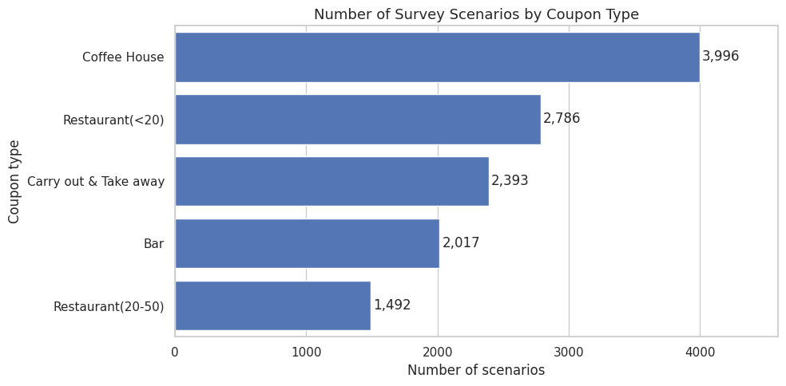
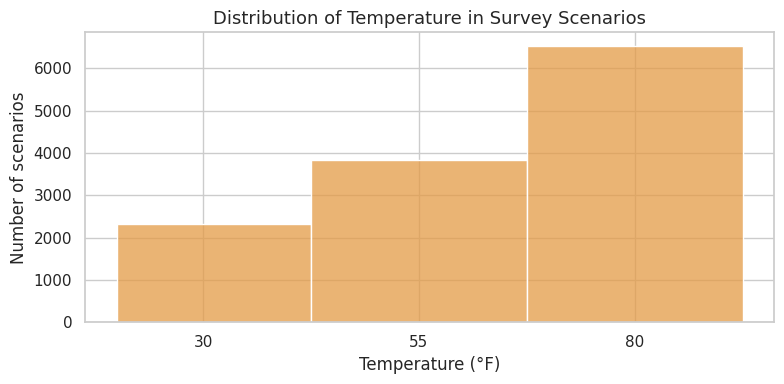
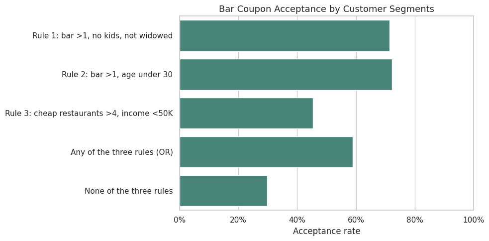
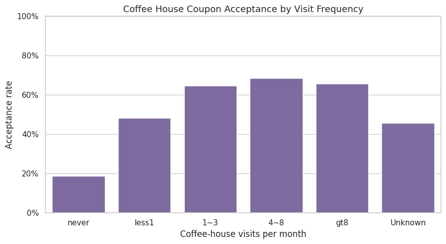
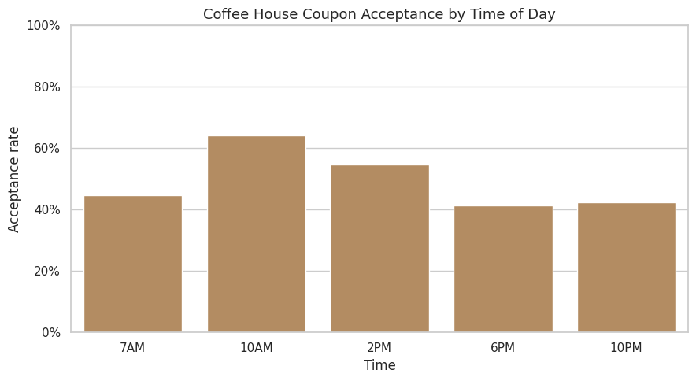
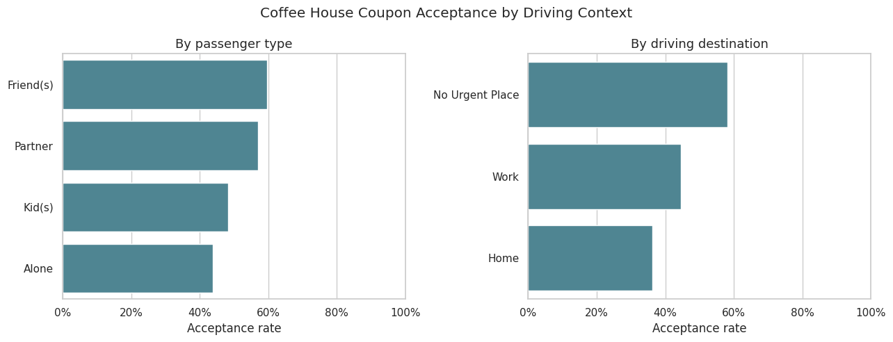

# Will the Customer Accept the Coupon?
### Required Assignment 5.1 | UC Berkeley Professional Certificate in Machine Learning & Artificial Intelligence

**Project type:** Exploratory Data Analysis (EDA) and business recommendations  
**Tools:** Python · Pandas · NumPy · Seaborn · Matplotlib · Jupyter Notebook  
**Dataset:** UCI In-Vehicle Coupon Recommendation (12,684 scenarios, 26 original columns)

> **Main takeaway:** Coupon acceptance is not uniform across customers or offers. Prior visits to the relevant venue are strongly associated with stated coupon acceptance. In the survey, 56.84% of all scenarios indicated acceptance, but the rates differed markedly for bar and Coffee House coupons and for different visit-frequency segments.

**Start here:** [📓 View the executed Jupyter Notebook](notebooks/coupon_acceptance_analysis.ipynb) · [📁 Dataset](data/coupons.csv) · [📊 Visualizations](outputs/) · [⚙️ Dependencies](requirements.txt)

---

## 1. Executive Summary

This project examines **12,684 hypothetical driving scenarios** to understand the customer characteristics and travel circumstances associated with willingness to accept a mobile coupon. The dataset includes the coupon category, driving context, passenger type, weather, time of day, demographic characteristics, and prior visits to different venue types.

The overall stated acceptance rate was **56.84% (7,210 of 12,684)**. The investigation first follows the course's required **bar-coupon questions** and then conducts an **independent Coffee House coupon analysis**. The strongest descriptive pattern across both groups is prior venue visitation: respondents who report visiting the corresponding venue more frequently tend to report greater willingness to accept that coupon.

This is a **descriptive, observational analysis**. It identifies potential marketing segments and testable hypotheses; it does **not** demonstrate causal effects or measure actual coupon redemption, purchases, or campaign profitability.

### Results at a glance

| Measure | Result | Interpretation |
|---|---:|---|
| All coupon scenarios | **56.84%** accepted (7,210 / 12,684) | Baseline for the full survey |
| Bar coupons | **41.00%** accepted (827 / 2,017) | Below the overall baseline |
| Bar visits >3 times/month | **76.9%** accepted (n=199) | High acceptance among frequent bar visitors |
| Bar visits ≤3 times/month | **37.1%** accepted (n=1,797) | Lower acceptance among less-frequent bar visitors |
| Bar visits >1/month **and** age >25 | **69.5%** accepted (n=420) | A higher-acceptance bar segment |
| Coffee House coupons | **49.92%** accepted (1,995 / 3,996) | Below the overall baseline |
| Coffee House visits ≥1/month | **66.0%** accepted (n=1,922) | Higher acceptance among regular visitors |
| Coffee House visits less often or unknown | **35.0%** accepted (n=2,074) | Comparison includes unknown-frequency responses |

**Business opportunity:** Test whether relevant offers sent to established customers perform better than broad distribution, while evaluating actual redemption, incremental revenue, costs, and customer experience.

---

## 2. Problem Statement

Businesses use coupons to attract customers, increase store visits, and encourage purchases. However, indiscriminately sending promotions can create unnecessary marketing expense, irrelevant customer messages, and disappointing conversion.

**The business problem is to determine which characteristics of customers and their driving situations are associated with a greater likelihood of accepting a coupon.** Understanding these relationships may help marketers form better targeting hypotheses and decide which promotions to test.

### Primary research question

**Which customer habits and driving conditions are associated with higher stated coupon acceptance, and how could businesses use those insights to design more relevant promotions?**

### Supporting research questions

1. What is the overall coupon acceptance rate?
2. How many observations belong to each coupon category?
3. How does coupon acceptance vary across different customer groups?
4. Do frequent bar visitors accept bar coupons more often than infrequent visitors?
5. Do age and other characteristics help distinguish higher-acceptance bar-coupon segments?
6. For an independently selected coupon type—**Coffee House**—how do visit frequency, time of day, expiration period, and passenger context relate to acceptance?
7. Which findings support practical business experiments, and what limitations must be considered?

---

## Table of Contents

**Evaluator quick links:** [Nontechnical report](#nontechnical-report-for-business-stakeholders) · [Accepted vs. rejected summary](#accepted-versus-rejected-statistical-summary) · [Inferential statistics](#98-inferential-statistics-coffee-house-visit-frequency) · [Key findings](#10-consolidated-findings-and-business-implications) · [Recommendations](#11-recommendations-priorities-and-success-measures) · [Next steps](#13-next-steps)

| Section | What you will find |
|---|---|
| [1. Executive Summary](#1-executive-summary) | Executive summary and headline metrics |
| [2. Problem Statement](#2-problem-statement) | Goal, problem statement, research questions |
| [3. Business Context and Decision Framework](#3-business-context-and-decision-framework) | Decision framework |
| [4. Dataset Overview](#4-dataset-overview) | Dataset and variables |
| [5. Data Understanding, Quality Checks, and Preparation](#5-data-understanding-quality-checks-and-preparation) | Missing data and preparation |
| [6. Tools, Code Quality, and Reproducibility](#6-tools-code-quality-and-reproducibility) | Libraries and reproducibility |
| [7. Exploratory Data Analysis](#7-exploratory-data-analysis) | Overall acceptance and exploration |
| [8. Required Investigation: Bar Coupons](#8-required-investigation-bar-coupons) | Bar coupon analysis |
| [9. Independent Investigation: Coffee House Coupons](#9-independent-investigation-coffee-house-coupons) | Coffee House analysis and statistical tests |
| [10. Consolidated Findings and Business Implications](#10-consolidated-findings-and-business-implications) | Consolidated findings and business actions |
| [11. Recommendations, Priorities, and Success Measures](#11-recommendations-priorities-and-success-measures) | Prioritized recommendations and success measures |
| [12. Statistical Interpretation and Limitations](#12-statistical-interpretation-and-limitations) | Statistical limitations |
| [13. Next Steps](#13-next-steps) | Further analysis and experiments |
| [14. Visualizations Gallery](#14-visualizations-gallery) | All seven charts |
| [15. Repository Structure](#15-repository-structure) | File structure |
| [16. How to Run the Notebook](#16-how-to-run-the-notebook) | How to run the notebook |
| [17. Assignment Rubric Alignment (20 Points)](#17-assignment-rubric-alignment-20-points) | Rubric checklist |
| [18. References and Attribution](#18-references-and-attribution) | References |
| [19. Project Information](#19-project-information) | Project information |

---

## Nontechnical Report for Business Stakeholders

**Goal.** Identify which customers are more receptive to mobile coupons so a business can design better-targeted promotions rather than sending the same offer to everyone.

**What we observed.** Across 12,684 hypothetical survey scenarios, **56.84%** of coupons were accepted and **43.16%** rejected. Results varied by coupon type: **41.0%** of Bar coupons and **49.9%** of Coffee House coupons were accepted. Customers who had visited the relevant type of venue more often were generally more receptive.

**The clearest Coffee House difference:** Among respondents reporting at least one Coffee House visit per month, **66.0% accepted** and **34.0% rejected** the coupon. Among those reporting less-frequent visits **or an unknown visit frequency**, **35.0% accepted** and **65.0% rejected**. That is a **31.0-percentage-point difference** in acceptance. The statistical tests in the notebook support an association between prior visits and stated acceptance, but they do not establish cause and effect.

**What a business could do.** Start with a small, randomized test of offers tailored to customers who already visit coffee houses; separately test delivery time (including 10 AM) and coupon expiration (one day versus two hours). Track **actual redemptions, incremental purchases, profit after discounts, and customer experience**, not just survey responses.

**Important caveat.** This dataset records hypothetical willingness to accept a coupon, not real purchases. Some respondents may appear in more than one scenario, and the comparison group includes unknown visit-frequency answers. Findings should guide experiments, not be treated as proven campaign results.

### Accepted-versus-Rejected Statistical Summary

| Coupon group / customer segment | Accepted | Rejected | Total | Acceptance rate | Rejection rate |
|---|---:|---:|---:|---:|---:|
| All coupon scenarios | 7,210 | 5,474 | 12,684 | **56.84%** | 43.16% |
| Bar coupons | 827 | 1,190 | 2,017 | **41.00%** | 59.00% |
| Coffee House coupons | 1,995 | 2,001 | 3,996 | **49.92%** | 50.08% |
| Coffee House: at least monthly | 1,269 | 653 | 1,922 | **66.02%** | 33.98% |
| Coffee House: less frequent or unknown | 726 | 1,348 | 2,074 | **35.00%** | 65.00% |

**Statistical evidence:** For the two Coffee House visit-frequency groups, Pearson's chi-square test gives **χ²(1) = 383.96, p = 1.71 × 10⁻⁸⁵**. The notebook also reports the two-proportion z-test and 95% Wilson confidence intervals. These tests assume independent observations; possible repeated respondents mean their nominal p-values should be interpreted cautiously. [View the accepted-versus-rejected chart](outputs/coffee_accepted_vs_rejected.png) or [inspect the notebook](notebooks/coupon_acceptance_analysis.ipynb).

---

## 3. Business Context and Decision Framework

The survey represents potential coupon offers shown to drivers under different conditions. For a real business, a successful coupon program should optimize **incremental business value**, not merely the percentage of people saying they would accept a coupon.

A possible marketing workflow is:

1. **Identify a relevant customer segment**, such as people who already visit coffee houses.
2. **Choose an appropriate offer** and delivery window.
3. **Test the offer against a randomized control group** rather than relying on historical differences alone.
4. **Measure real outcomes:** redemption, purchases, incremental revenue, discount expense, and customer satisfaction.
5. **Scale only if the experiment demonstrates positive incremental value** and complies with privacy, safety, and applicable marketing requirements.

The present project supports **Step 1: exploratory segmentation and hypothesis development**.

---

## 4. Dataset Overview

**Dataset:** *In-Vehicle Coupon Recommendation*  
**Source:** UCI Machine Learning Repository; CSV provided with the Berkeley assignment starter materials.  
**Unit of analysis:** A survey response to a hypothetical driving-and-coupon scenario.  
**Original size:** **12,684 rows × 26 columns**.  
**Target:** `Y`, where `1` means the respondent indicated willingness to use the coupon before expiry and `0` means rejection.

### Key variable groups

| Group | Columns / examples | Why they matter |
|---|---|---|
| Coupon and outcome | `coupon`, `expiration`, `Y` | Offer category, urgency, and response |
| Driving context | `destination`, `passanger`, `direction_same`, `direction_opp` | Where the driver is going and with whom |
| Time and conditions | `time`, `weather`, `temperature` | Context in which the offer is presented |
| Proximity | `toCoupon_GEQ5min`, `toCoupon_GEQ15min`, `toCoupon_GEQ25min` | Travel-time indicators |
| Demographics | `age`, `gender`, `maritalStatus`, `has_children`, `education`, `occupation`, `income` | Descriptive customer attributes |
| Prior venue visits | `Bar`, `CoffeeHouse`, `CarryAway`, `RestaurantLessThan20`, `Restaurant20To50` | Self-reported behavior and familiarity |
| Vehicle | `car` | Largely missing in the supplied dataset |

> **Dataset naming note:** `passanger` is spelled that way in the source data. The notebook retains the original column name for compatibility.

The five coupon categories are **Bar**, **Coffee House**, **Carry Out & Take Away**, **Restaurant (<$20)**, and **Restaurant ($20–$50)**.

### Coupon distribution

The first chart shows how many scenarios belong to each coupon category. Counts matter because an acceptance rate based on a small segment is less stable than one based on a larger segment.



---

## 5. Data Understanding, Quality Checks, and Preparation

Before analyzing acceptance rates, the notebook examines the dataset's shape, columns, response distribution, and missing values.

### 5.1 Missing values

| Column | Missing responses | Approx. share |
|---|---:|---:|
| `car` | 12,576 | 99.15% |
| `Bar` | 107 | 0.84% |
| `CoffeeHouse` | 217 | 1.71% |
| `CarryAway` | 151 | 1.19% |
| `RestaurantLessThan20` | 130 | 1.02% |
| `Restaurant20To50` | 189 | 1.49% |

**Decisions used in this project:**

- **Drop `car` from the analysis dataset.** With about 99.15% of values missing, it provides little reliable information for this investigation.
- **Preserve observations with missing venue-frequency answers.** Instead of discarding an otherwise useful row, missing visit-frequency responses are labeled **`Unknown`** in the cleaned dataset.
- **Do not infer visit frequency from other attributes.** Replacing a missing response with a guessed frequency could distort the observed relationship with acceptance.
- **Keep 74 exact duplicate rows.** The data do not include a unique respondent identifier; two identical scenario records cannot confidently be treated as an accidental duplicate.
- **Keep all 12,684 observations** for the overall analysis. Specific comparisons may exclude unknown visit-frequency values or explicitly group them with less-frequent respondents, as described in the relevant section.

These choices are documented in the notebook. The source CSV remains unchanged in `data/`.

### 5.2 Why preparation matters

A different cleaning strategy can change the overall acceptance rate and segment sizes. For example, deleting every row with a missing visit-frequency response would produce a different analysis population. This project deliberately retains rows and clearly identifies when `Unknown` is included or excluded.

### 5.3 Data types and analysis approach

Most explanatory fields are categorical or ordinal survey responses. Accordingly, the analysis focuses on **frequency tables, grouped acceptance rates, cross-segment comparisons, and visualizations** rather than treating every category as a continuous numeric variable.

For a segment \(S\), the acceptance rate is calculated as:

\[
\text{Acceptance Rate}(S)
=
\frac{\text{Number of scenarios with }Y=1\text{ in }S}
{\text{Total scenarios in }S}
\times 100\%.
\]

**Percentage-point differences** are used when comparing two acceptance rates. They should not be confused with relative percentage increases.

---

## 6. Tools, Code Quality, and Reproducibility

### Libraries

- **Pandas:** CSV loading, missing-value inspection, filtering, grouping, counts, and acceptance-rate calculations.
- **NumPy:** Numerical operations and array-oriented support.
- **Matplotlib:** Plot layout, axis labels, titles, and formatting.
- **Seaborn:** Readable categorical comparisons and statistical visualizations.
- **Jupyter Notebook:** Executable analysis, explanatory Markdown, charts, and results in one document.

### Code organization

The notebook follows the assignment's original sequence and contains code and explanatory text for data exploration, required bar-coupon questions, independent investigation, and conclusions. The notebook was executed to populate its displayed results and charts.

**[Open the complete notebook](notebooks/coupon_acceptance_analysis.ipynb)** to inspect the calculations, plots, and reasoning rather than relying only on this summary.

---

## 7. Exploratory Data Analysis

### 7.1 Overall acceptance

| Outcome | Scenarios | Share |
|---|---:|---:|
| Accepted (`Y=1`) | **7,210** | **56.84%** |
| Not accepted (`Y=0`) | **5,474** | **43.16%** |
| **Total** | **12,684** | **100%** |

**Finding:** The full dataset shows more acceptance than rejection. However, this average is not sufficient for campaign decisions because coupon categories and customer habits differ.

### 7.2 Temperature distribution

The notebook examines the distribution of scenarios across recorded temperatures.



**Interpretation:** Temperature is part of the driving context and is useful for describing the dataset. A distribution chart alone does not demonstrate that temperature causes higher or lower acceptance.

---

## 8. Required Investigation: Bar Coupons

The assignment's guided analysis asks whether bar-coupon acceptance differs by prior bar visits and selected customer characteristics.

### 8.1 Baseline bar-coupon acceptance

| Measure | Value |
|---|---:|
| Bar-coupon scenarios | **2,017** |
| Accepted bar coupons | **827** |
| Bar-coupon acceptance | **41.00%** |
| Overall coupon acceptance | **56.84%** |
| Difference from overall | **−15.84 percentage points** |

**Finding:** Bar coupons have a lower stated acceptance rate than the overall survey average. This motivates examining which bar-coupon recipients are more receptive.

### 8.2 Does prior bar visitation matter?

| Bar visits per month | Scenarios | Acceptance |
|---|---:|---:|
| **3 or fewer** | 1,797 | **37.1%** |
| **More than 3** | 199 | **76.9%** |

The difference is approximately **39.8 percentage points**. **Twenty-one** bar-coupon scenarios with unknown bar-visit frequency are excluded from this comparison.

**Interpretation:** People who already visit bars frequently report much higher acceptance of bar coupons. This is consistent with the idea that an offer related to an established customer interest may be more relevant.

**Business implication:** Prior venue engagement is a promising variable for a controlled coupon-targeting experiment. The >3-visits group is much smaller than the ≤3-visits group, so its estimate should be validated before making broad operational decisions.

### 8.3 Bar visits and age

| Segment | Scenarios | Acceptance |
|---|---:|---:|
| Visits bars **>1/month** and **age >25** | 420 | **69.5%** |
| Other bar-coupon scenarios | 1,597 | **33.5%** |

**Finding:** Combining reported bar-visit frequency with age identifies a segment with a higher observed acceptance rate.

**Interpretation:** This is an exploratory association, not evidence that age causes acceptance. In practical targeting, behavior may be more defensible and useful than relying on demographic characteristics.

### 8.4 Additional segment conditions

The notebook explores combinations of behavioral and contextual variables, including:

- Bar visits **>1/month**, **no child passenger**, and a non-farming occupation: **71.3%** acceptance (**n=551**).
- Bar visits **>1/month**, **no child passenger**, and not widowed: **71.3%** acceptance (**n=551**).
- Bar visits **>1/month** and **age under 30**: **72.2%** acceptance (**n=345**).
- Cheap-restaurant visits **>4/month** and income below **$50,000**: **45.3%** acceptance (**n=344**).

The alternative conditions are not mutually exclusive. They should **not** be added together as if they were independent groups.



### 8.5 Bar-coupon hypothesis and conclusion

**Hypothesis:** Customers with a history of visiting bars are more likely to accept a bar coupon than customers who rarely visit bars.

**Observed evidence:** The 76.9% acceptance rate among respondents reporting >3 bar visits per month is considerably above the 37.1% rate among those reporting ≤3 visits.

**Conclusion:** The survey supports an **association between prior bar-going behavior and stated bar-coupon acceptance**. It does not establish whether targeting that segment would increase actual incremental sales.

**Suggested test:** Run a controlled campaign comparing relevant bar offers for eligible high-frequency visitors against a randomized baseline, subject to legal, age, privacy, and marketing constraints.

---

## 9. Independent Investigation: Coffee House Coupons

The independent investigation focuses on **Coffee House** coupons. This category is useful because it represents a common everyday purchase context and allows investigation of customer habits alongside timing and passenger context.

### 9.1 Independent research question

**Are customers who already visit coffee houses more likely to accept Coffee House coupons, and which situational factors suggest useful follow-up targeting experiments?**

### 9.2 Baseline Coffee House acceptance

| Measure | Value |
|---|---:|
| Coffee House scenarios | **3,996** |
| Accepted | **1,995** |
| Acceptance rate | **49.92%** |
| Difference from overall acceptance | **−6.92 percentage points** |

### 9.3 Prior Coffee House visit frequency

| Reported Coffee House visits | Scenarios | Acceptance |
|---|---:|---:|
| **At least once/month** | 1,922 | **66.0%** |
| **Less frequent or unknown** | 2,074 | **35.0%** |

The observed gap is approximately **31.0 percentage points**.

**Interpretation:** Familiarity with the venue type is associated with substantially higher willingness to accept its coupons. Because the comparison group includes unknown visit-frequency answers, it should not be described as consisting entirely of infrequent visitors.



**Business implication:** A coffee retailer could test loyalty-based or previous-visit-based coupon targeting. A separate acquisition campaign could investigate what motivates customers who rarely visit coffee houses.

### 9.4 Time of day

| Time | Scenarios | Acceptance |
|---|---:|---:|
| **7 AM** | 913 | **44.6%** |
| **10 AM** | 899 | **64.1%** |
| **2 PM** | 794 | **54.8%** |
| **6 PM** | 1,093 | **41.3%** |
| **10 PM** | 297 | **42.4%** |

**Finding:** Among the time categories examined, **10 AM** has the highest observed Coffee House coupon acceptance (**64.1%**).

**Interpretation:** This may reflect a better match between the offer and customers' activities at that time. However, differences in respondent composition and other contextual factors may also contribute.



**Suggested test:** Compare a 10 AM Coffee House promotion with another delivery time using randomized assignment and actual redemption as the outcome.

### 9.5 Coupon expiration

| Coupon expiration | Scenarios | Acceptance |
|---|---:|---:|
| **1 day** | 1,769 | **58.4%** |
| **2 hours** | 2,227 | **43.2%** |

The observed difference is approximately **15.2 percentage points** in favor of one-day expiration.

**Interpretation:** A longer validity window may be more convenient, but this survey comparison cannot establish that extending expiration alone would produce the same effect.

**Suggested test:** Randomly vary expiration periods while holding the offer and audience as consistent as possible.

### 9.6 Passenger context

| Passenger context | Acceptance |
|---|---:|
| **Friends** | **59.7%** |
| **Partner** | **57.0%** |
| **Kids** | **48.3%** |
| **Alone** | **43.8%** |

**Finding:** Coffee House coupon acceptance is higher in scenarios with friends or a partner than in scenarios where the driver is alone.

**Interpretation:** Social context could affect the appeal of a coffee stop, but the dataset does not prove that passenger presence causes acceptance.



### 9.7 Independent-investigation conclusion

The strongest actionable descriptive result is **past Coffee House visitation**. Time of day, expiration, and passenger context provide additional hypotheses:

- Test behavior-based targeting among regular Coffee House visitors.
- Test delivery around **10 AM** against alternative times.
- Test whether **one-day expiration** improves actual redemption versus shorter expiration.
- Explore social-context differences without assuming that passenger characteristics are causal or appropriate for real-time targeting.

---


### 9.8 Inferential statistics: Coffee House visit frequency

To evaluate whether the observed acceptance-rate difference could plausibly arise under equal population rates, the notebook adds a **Pearson chi-square test of independence**, an equivalent **two-sided two-proportion z-test**, and **95% Wilson confidence intervals**. The null hypothesis is equal acceptance probability for customers visiting at least monthly and the remaining respondents (including unknown frequency).

- At least monthly: **1,269 accepted / 1,922 scenarios = 66.0%**.
- Less than monthly or unknown: **726 accepted / 2,074 scenarios = 35.0%**.
- Difference: **31.0 percentage points**.
- Pearson chi-square: **χ²(1) = 383.96, p = 1.71e-85**. At α = 0.05, reject the null of independence.

**Interpretation:** Higher prior Coffee House visitation is statistically associated with higher coupon acceptance in these survey scenarios. This is **not causal evidence**: repeated respondent observations may violate the independence assumption, and the comparison group includes unknown visit frequency. See the notebook for the two-proportion z-test and Wilson confidence intervals. Validate any targeting strategy in a randomized experiment.


### Additional visualization: accepted versus rejected

The [100% stacked outcome chart](outputs/coffee_accepted_vs_rejected.png) explicitly compares **accepted and rejected** Coffee House coupons in each visit-frequency group. Regular visitors accepted 66.0% and rejected 34.0%; the less-frequent/unknown group accepted 35.0% and rejected 65.0%. This directly supports the rubric requirement to compare customers who accepted versus rejected coupons. The grouping includes respondents with unknown visit frequency, so it should not be interpreted as a pure comparison of known regular and infrequent visitors.

## 10. Consolidated Findings and Business Implications

| # | Finding | Evidence | Potential action |
|---|---|---|---|
| 1 | Overall stated acceptance exceeds 50% | **56.84%** across 12,684 scenarios | Use as a survey-wide descriptive baseline |
| 2 | Bar coupons underperform the overall baseline | **41.00%** versus 56.84% | Avoid assuming equal performance across coupon categories |
| 3 | Frequent bar visitors are more receptive | **76.9%** (>3 visits/month) versus 37.1% (≤3) | Test relevance-based bar offers in eligible audiences |
| 4 | Bar visit frequency combined with age identifies a higher-rate segment | **69.5%**, n=420 | Validate whether behavior alone explains most of the difference |
| 5 | Regular Coffee House visitors are more receptive | **66.0%** versus 35.0% | Test customer-history-based coffee offers |
| 6 | Coffee House acceptance varies by time | **64.1% at 10 AM** | A/B test timing |
| 7 | Longer Coffee House coupon validity correlates with higher acceptance | **58.4%** (1 day) versus 43.2% (2 hours) | A/B test expiration |
| 8 | Coffee House acceptance varies by passenger context | **59.7%** with friends versus 43.8% alone | Explore context cautiously; prioritize privacy and safety |

**Important distinction:** These are *observed associations within survey scenarios*, not estimates of the causal impact of marketing actions.

---

## 11. Recommendations, Priorities, and Success Measures

### Priority 1 — Start with customer relevance

**Recommendation:** Pilot offers aligned with customers' reported prior venue visits.

**Rationale:** Prior venue visitation shows large acceptance-rate differences in both the bar and Coffee House analyses.

**Measure:** Incremental redemption and incremental profit versus randomized controls—not just stated willingness to accept.

### Priority 2 — Experiment with Coffee House timing and expiration

**Recommendation:** Test a **10 AM** send window and **one-day** expiration against comparison treatments.

**Rationale:** These conditions are associated with higher acceptance in the observed survey data.

**Measure:** Redemption rate, cost per incremental redemption, customer engagement, and margin after discounts.

### Priority 3 — Avoid blanket targeting based on demographic characteristics

**Recommendation:** Prefer relevant, permissioned behavioral signals when possible. Treat demographic patterns as exploratory rather than automatic deployment rules.

**Rationale:** Demographic associations may reflect other factors, may not generalize, and can raise fairness or privacy concerns.

**Measure:** Segment stability, fairness review, opt-out rates, and business lift.

### Priority 4 — Validate the reliability of narrow segments

**Recommendation:** Report segment sample sizes and uncertainty before using highly specific targeting rules.

**Rationale:** Small groups may show apparently large rates due to sampling variability or exploratory selection.

**Measure:** Confidence intervals, holdout-sample performance, and stability over time.

### Priority 5 — Evaluate the economics of coupons

**Recommendation:** Calculate the true value of an offer after discounts, fulfillment, and marketing costs.

**Rationale:** Higher acceptance is not necessarily higher profitability.

**Measure:** Incremental revenue, gross margin, repeat purchase, and return on promotional spend.

---

## 12. Statistical Interpretation and Limitations

### What the results support

The analysis supports **descriptive comparisons of conditional acceptance rates** within the supplied survey. It provides evidence of associations between stated acceptance and variables such as visit frequency, time, expiration, and passenger context.

### What the results do not support

The analysis does **not** establish:

- That any single factor *causes* a higher acceptance rate.
- That the same rates will occur in a real production campaign.
- That accepting a coupon leads to actual redemption or purchase.
- That a higher acceptance rate necessarily improves profitability.
- That results from narrow or overlapping segments will remain stable in new samples.

### Specific limitations

1. **Hypothetical responses:** `Y` records stated willingness, not verified purchases.
2. **Observational comparisons:** Groups may differ on multiple variables simultaneously.
3. **Possible respondent overlap:** No unique respondent ID is provided for independent-person analysis.
4. **Missing frequency answers:** `Unknown` values are retained and treated explicitly.
5. **Exploratory subgroup selection:** Examining many combinations can surface apparently strong patterns by chance.
6. **Unequal sample sizes:** Some high-rate groups have relatively few observations.
7. **Generalizability:** Survey participants and scenarios may not represent every business, region, or current consumer behavior.
8. **Privacy and safety:** Contextual marketing should not encourage unsafe interaction while driving; real campaigns require appropriate consent and compliance.

**Statistical note:** The percentages in this README are **descriptive estimates**. The Coffee House visit-frequency comparison includes a chi-square test, a two-proportion z-test, and Wilson confidence intervals in the notebook. No causal model was performed.

---

## 13. Next Steps

1. **Extend uncertainty estimates:** Calculate confidence intervals for additional coupon groups and for between-group acceptance-rate differences; the Coffee House frequency comparison already includes 95% Wilson intervals.
2. **Validate subgroup patterns:** Use held-out data or repeat samples where available.
3. **Control for overlapping factors:** Consider multivariable models to assess whether patterns persist after accounting for other measured attributes.
4. **Evaluate classification models:** Compare simple baselines with logistic regression or tree-based models using appropriate validation and metrics.
5. **Design real-world experiments:** Randomize eligible customers to offer strategies and measure actual redemption and incremental value.
6. **Monitor responsible use:** Evaluate privacy, consent, fairness, and driver safety before deployment.

These are **future directions**, not claims about analyses already performed.

---

## 14. Visualizations Gallery

The following charts are generated by the completed notebook and stored in `outputs/`. The separate `images/` folder is reserved for original figures supplied with the assignment; no such standalone files were present in the available project materials, so none have been invented or mislabeled.

| Figure | Description |
|---|---|
| [Coupon type counts](outputs/coupon_type_counts.png) | Distribution of scenarios by coupon category |
| [Temperature distribution](outputs/temperature_distribution.png) | Driving-scenario temperature distribution |
| [Bar segment acceptance](outputs/bar_segment_acceptance.png) | Acceptance comparisons for selected bar-coupon groups |
| [Coffee visit frequency](outputs/coffee_visit_frequency.png) | Acceptance by prior Coffee House visitation |
| [Coffee time of day](outputs/coffee_time_of_day.png) | Coffee House acceptance across survey time categories |
| [Coffee driving context](outputs/coffee_driving_context.png) | Coffee House acceptance across passenger and destination context |
| [Accepted versus rejected outcomes](outputs/coffee_accepted_vs_rejected.png) | Stacked comparison of both coupon outcomes by Coffee House visit frequency |

For calculation details and explanatory comments, see the **[Jupyter Notebook](notebooks/coupon_acceptance_analysis.ipynb)**.

---

## 15. Repository Structure

This project is designed to live inside the user's main Berkeley coursework repository:

```text
Trilok_Berkley_AI_ML_PC/
└── Module_05/
    └── Assignment_5_1_Coupon_Acceptance/
        ├── README.md
        ├── requirements.txt
        ├── .gitignore
        ├── data/
        │   └── coupons.csv
        ├── notebooks/
        │   └── coupon_acceptance_analysis.ipynb
        └── outputs/
            ├── coupon_type_counts.png
            ├── temperature_distribution.png
            ├── bar_segment_acceptance.png
            ├── coffee_visit_frequency.png
            ├── coffee_time_of_day.png
            ├── coffee_driving_context.png
            └── coffee_accepted_vs_rejected.png
```

**File organization rationale:** The README sits at the assignment root; the notebook lives in `notebooks/`; raw data live in `data/`; generated charts live in `outputs/`; dependencies are listed in `requirements.txt`. No temporary analysis files are required for submission.

---

## 16. How to Run the Notebook

### Prerequisites

- Python and Jupyter Notebook (Anaconda is suitable).
- The Python packages listed in [`requirements.txt`](requirements.txt).

### Instructions

1. Download or clone the repository.
2. Navigate to `Module_05/Assignment_5_1_Coupon_Acceptance/`.
3. Ensure `data/coupons.csv` is present in the project root.
4. Install dependencies if necessary:

   ```bash
   python -m pip install -r requirements.txt
   ```

5. Launch Jupyter Notebook:

   ```bash
   jupyter notebook
   ```

6. Open [`coupon_acceptance_analysis.ipynb`](notebooks/coupon_acceptance_analysis.ipynb).
7. Select the appropriate Python kernel.
8. Run **Kernel → Restart & Run All** (wording may vary by Jupyter version).
9. Review the executed cells, output tables, charts, and conclusions.

The notebook resolves the dataset from either `../data/coupons.csv` (when launched from `notebooks/`) or `data/coupons.csv` (when launched from the project root). Keep the project folder structure intact.

---

## 17. Assignment Rubric Alignment (20 Points)

This README is organized to help the grader find evidence for each **5-point criterion**. The rubric evaluates the **entire submission**, not the README alone; the notebook and its actual execution must also satisfy the requirements.

| Rubric category | Requirements | Where to verify |
|---|---|---|
| **Project Organization — 5 pts** | README with summary and notebook link; readable notebook headings and text; no unnecessary files; appropriate file and folder names | README §§1, 15–16; [Notebook](notebooks/coupon_acceptance_analysis.ipynb); `data/`, `notebooks/`, `outputs/` |
| **Syntax & Code Quality — 5 pts** | Correct imports and aliases; error-free execution; concise outputs; competent Pandas and Seaborn usage; useful comments and sensible variables | [Executed notebook](notebooks/coupon_acceptance_analysis.ipynb), especially data inspection, group calculations, and plot cells |
| **Visualizations — 5 pts** | Appropriate categorical/continuous plots; readable labels, descriptive titles, legible axes, appropriate subplots and scales | README §§7–9, 14; seven charts in [`outputs/`](outputs/); notebook visualizations |
| **Findings — 5 pts** | Clearly stated problem for a coupon group; accepted-versus-rejected comparisons; correct and concise statistical interpretation; clearly stated findings, actionable recommendations, and next steps | README §§2, 8–13; notebook conclusions |

**Submission quality checklist:** Confirm that every link resolves in GitHub, the notebook opens with visible outputs, all seven charts render, the dataset is present, and the notebook runs from start to finish without errors.

---

## 18. References and Attribution

- **Dataset:** UCI Machine Learning Repository — *In-Vehicle Coupon Recommendation*.
- **Course:** UC Berkeley Professional Certificate in Machine Learning & Artificial Intelligence, Required Assignment 5.1.
- **Analysis:** Original descriptive exploration of the supplied dataset, with required bar-coupon questions and an independent Coffee House investigation.

---

## 19. Project Information

**Assignment:** Required Assignment 5.1 — *Will the Customer Accept the Coupon?*  
**Program:** UC Berkeley Professional Certificate in Machine Learning & Artificial Intelligence  
**Repository:** `Trilok_Berkley_AI_ML_PC`  
**Notebook:** [`coupon_acceptance_analysis.ipynb`](notebooks/coupon_acceptance_analysis.ipynb)

*This README summarizes an exploratory educational project. Recommendations are hypotheses for future validation, not proven causal interventions.*
