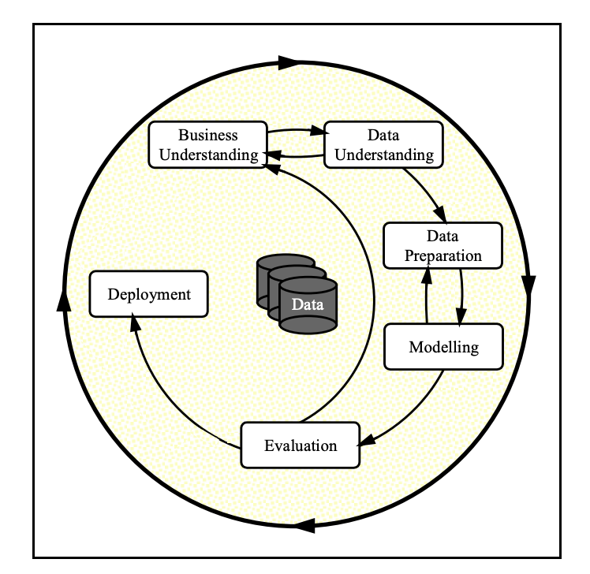
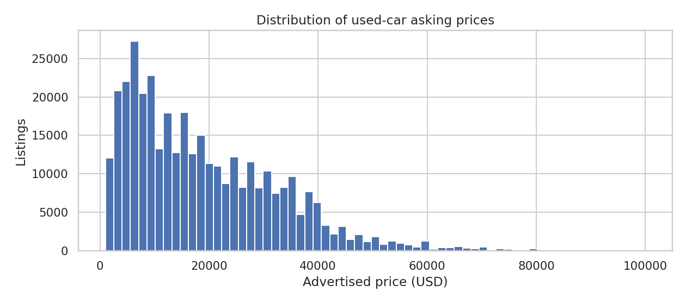
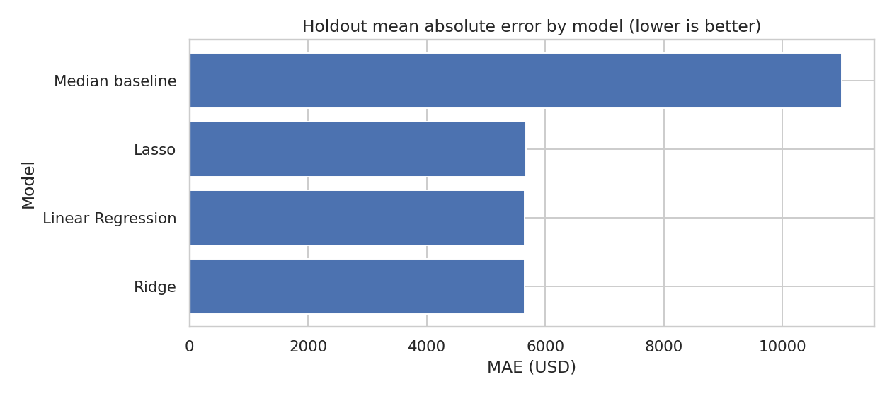

# What Drives the Price of a Car?

**UC Berkeley Professional Certificate in Machine Learning & AI — Module 11, Practical Application II**  
**Business audience:** Used-car dealerships  
**Methodology:** CRISP-DM | **Outcome:** Used-car **advertised** price (USD)  
**Author:** Trilok Reddy Arava

> **Executive takeaway:** On a reproducible sample of 40,000 filtered listings, Ridge Regression achieved a holdout mean absolute error of **$5,656**, compared with **$10,998** for a median-price baseline (about **49%** lower error). These are asking-price estimates, not verified transaction values.

## Table of Contents

1. [Executive Summary](#executive-summary)
2. [Business Problem and CRISP-DM](#business-problem-and-crisp-dm)
3. [Data Understanding](#data-understanding)
4. [Data Preparation and Cleaning](#data-preparation-and-cleaning)
5. [Exploratory Visualizations](#exploratory-visualizations)
6. [Modeling and Validation](#modeling-and-validation)
7. [Key Findings](#key-findings)
8. [Recommendations for Dealerships](#recommendations-for-dealerships)
9. [Limitations and Next Steps](#limitations-and-next-steps)
10. [Repository Navigation](#repository-navigation)
11. [Reproduce the Analysis](#reproduce-the-analysis)
12. [Rubric Checklist](#rubric-checklist)

## Executive Summary

This project studies which characteristics are **associated** with used-car listing prices and whether interpretable regression models can predict asking prices more accurately than a simple median-price baseline. The supplied dataset includes **426,880 advertisements**. After documented validity filters, **367,371** listings remain. For practical laptop execution, modeling uses a fixed random sample of 40,000 cleaned listings.

The recommended model is **Ridge Regression**, which had the lowest observed test MAE among the tested models. This result is specific to the defined filters, random sample, and test split; the tiny difference from ordinary least squares does not prove Ridge is universally superior.

**[Open the fully executed Jupyter notebook](notebooks/used_car_price_analysis.ipynb)** · **[View execution evidence](Execution_Screenshots/notebook_execution.png)** · **[View model metrics](outputs/reports/model_performance.csv)**

## Business Problem and CRISP-DM

Dealers need consistent evidence for asking-price decisions and inventory review. We use the six-phase CRISP-DM process: business understanding, data understanding, data preparation, modeling, evaluation, and deployment (communication of recommendations).

**Notebook sections:** [1. Business Understanding](notebooks/used_car_price_analysis.ipynb) · [2. Data Understanding](notebooks/used_car_price_analysis.ipynb) · [3. Data Preparation](notebooks/used_car_price_analysis.ipynb) · [4. Modeling](notebooks/used_car_price_analysis.ipynb) · [5. Evaluation](notebooks/used_car_price_analysis.ipynb) · [6. Deployment](notebooks/used_car_price_analysis.ipynb). The notebook contains matching numbered headings and subsections (1.1–6.4).

## Data Understanding

The provided `data/vehicles.csv` has **426,880 rows and 18 fields**, including price, year, manufacturer, model, condition, odometer, fuel, transmission, vehicle type and state. Missingness is substantial in some fields; for example, `size` is missing in roughly 72% and `condition` in roughly 41% of records. The notebook inspects invalid prices and data completeness before modeling.

- [Data source and handling notes](data/README.md)
- [Missing-value audit](outputs/reports/missing_values.csv)

## Data Preparation and Cleaning

The notebook first de-duplicates listing IDs, then retains records with price **$1,000–$100,000**, model year **1980–2022**, and odometer **0–350,000 miles**. These are transparent analytical restrictions, not universal definitions of valid cars. The filtered dataset contains **367,371** listings (**59,509** excluded). We derive vehicle age relative to 2026, impute missing values within the modeling pipeline, scale numeric variables, and one-hot encode categorical fields.

- [Cleaning summary and counts](outputs/reports/data_cleaning_summary.csv)
- [Full cleaning logic in notebook](notebooks/used_car_price_analysis.ipynb)

## Exploratory Visualizations

All figures are produced by notebook execution and saved to [outputs/figures/](outputs/figures/).

| Figure | What it shows |
|---|---|
| [Price distribution](outputs/figures/price_distribution.png) | Range and concentration of asking prices |
| [Price vs mileage](outputs/figures/price_vs_odometer.png) | Mileage/price association |
| [Price vs vehicle age](outputs/figures/price_by_vehicle_age.png) | Age/price association |
| [Manufacturer comparison](outputs/figures/price_by_manufacturer.png) | Median prices for common manufacturers |
| [Vehicle-type comparison](outputs/figures/price_by_vehicle_type.png) | Median prices by vehicle body type |
| [Model comparison](outputs/figures/model_comparison.png) | Holdout MAE across regressors |
| [Ridge coefficients](outputs/figures/ridge_coefficients.png) | Selected conditional model associations |

## Modeling and Validation

**Models:** Median baseline, Linear Regression, Ridge Regression and Lasso Regression. **Design:** 80/20 random train/test split of a reproducible 40,000-listing sample; three-fold cross-validation and `GridSearchCV` for model comparison/tuning. Imputation, scaling and one-hot encoding occur *inside* each fitted pipeline to avoid leakage.

**Primary metric: Mean Absolute Error (MAE)** — average absolute pricing error in USD, understandable to dealership staff. RMSE and R² are supplementary metrics.

| Model | CV MAE | Holdout MAE | Holdout RMSE | Holdout R² |
|---|---:|---:|---:|---:|
| Ridge | $5,668 | $5,656 | $7,921 | 0.682 |
| Linear Regression | $5,673 | $5,657 | $7,920 | 0.682 |
| Lasso | $5,679 | $5,670 | $7,960 | 0.679 |
| Median baseline | $11,057 | $10,998 | $14,458 | -0.059 |

**Hyperparameter selection:** Ridge alpha = 10; Lasso alpha = 10 in this run. See [full performance report](outputs/reports/model_performance.csv) and [Ridge coefficient report](outputs/reports/ridge_coefficients.csv). Numeric coefficients represent a one-standard-deviation change; one-hot category coefficients are conditional on the model's encoding and are not causal effects.

## Key Findings

1. **Prediction is substantially better than a naive baseline.** Ridge reduced holdout MAE by about 49% versus the median-price predictor in the specified sample.
2. **Vehicle age and mileage are useful pricing signals.** The notebook visualizes their unadjusted relationships and estimates adjusted linear-model coefficients.
3. **Manufacturer and vehicle type matter for benchmarking.** Group medians differ, but raw comparisons also reflect differences in age, mileage, and vehicle mix; see [manufacturer summary](outputs/reports/manufacturer_summary.csv) and [vehicle type summary](outputs/reports/vehicle_type_summary.csv).
4. **Listing quality limits certainty.** Many attributes are missing; some records have implausible prices. Exclusion rules and missing-data handling affect generalizability.
5. **Ridge narrowly leads on this split.** Its performance is close to ordinary least squares, so choosing Ridge should not be interpreted as a statistically proven win.

## Recommendations for Dealerships

1. **Benchmark asking prices by comparable vehicles** with similar age, mileage, manufacturer and body type; do not rely on brand-level medians alone.
2. **Flag outliers for manual review:** compare proposed listing prices with model estimates, but retain dealer judgment for unusual vehicles.
3. **Improve data capture:** consistently collect condition, title status, drivetrain and accurate odometer readings to strengthen pricing analysis.
4. **Segment inventory reviews** by vehicle type and region, where price structures may differ.
5. **Validate against realized sales and days-on-lot** before drawing conclusions about actual consumer willingness to pay.

## Limitations and Next Steps

- The target is **advertised asking price**, not a completed transaction or consumer willingness to pay.
- Filters remove unusual listings and may limit applicability to rare/low-cost/high-end vehicles.
- Modeling uses a 40,000-row sample from 367,371 filtered rows; results are sample-specific.
- Random splitting does not assess future-market drift. Validate on time-separated, region-specific and actual sales datasets.
- Model coefficients are **associations**, not causal explanations. Category encoding and correlated features affect coefficient interpretation.
- Next: add sales outcomes, vehicle trim/market history, segment-level error analysis, and monitoring for drift.

## Repository Navigation

| Folder or file | Description |
|---|---|
| [notebooks/used_car_price_analysis.ipynb](notebooks/used_car_price_analysis.ipynb) | Executed CRISP-DM notebook, code, charts and outputs |
| [data/](data/) | Course-supplied source dataset and provenance notes |
| [images/](images/) | Supplied CRISP-DM diagram and illustration |
| [Execution_Screenshots/](Execution_Screenshots/) | Execution-results evidence image and notes |
| [outputs/figures/](outputs/figures/) | Generated PNG charts |
| [outputs/reports/](outputs/reports/) | Cleaning, missingness, model metrics and coefficients CSVs |

## Reproduce the Analysis

1. Use Python 3.10+ with `pandas`, `numpy`, `matplotlib`, `seaborn`, `scikit-learn`, `jupyter` and `ipykernel`.
2. Confirm `data/vehicles.csv` is present (included in the downloadable project ZIP).
3. Open `notebooks/used_car_price_analysis.ipynb` in Jupyter and select a Python kernel.
4. Run **Kernel → Restart & Run All**. The notebook saves figures and reports automatically under `outputs/`.
5. Inspect the executed cell outputs and [execution evidence](Execution_Screenshots/notebook_execution.png). Results should be reproducible with the fixed random seed; library-version differences may produce minor changes.

**Install:** `pip install -r requirements.txt`

## Rubric Checklist

| Grading category | Evidence |
|---|---|
| Organization (5) | README with TOC, notebook link, structured folders, no extraneous analysis files |
| Syntax/code quality (5) | Executed notebook, pandas, seaborn styling, clear variable names and comments |
| Visualizations (5) | Seven labeled figures covering continuous and categorical features |
| Modeling (5) | Four models, three-fold CV, GridSearchCV, coefficients, MAE/RMSE/R² rationale |
| Findings (5) | Executive summary, data-cleaning audit, business recommendations, limitations and next steps |

**Submission:** Push this project folder to your public GitHub repository and submit its GitHub URL in the course portal.
