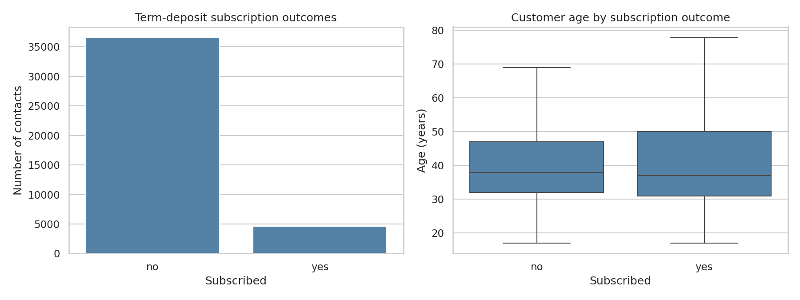
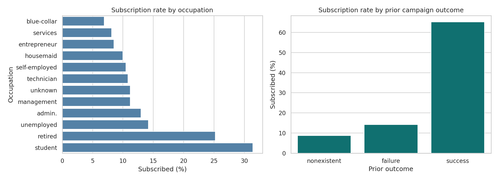
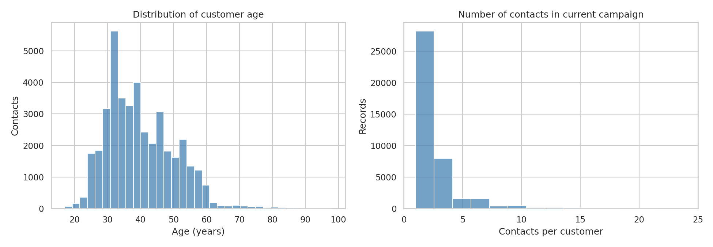

# Comparing Classifiers — Bank Term-Deposit Marketing

**UC Berkeley Professional Certificate in Machine Learning & AI | Required Assignment 17.1**

## Executive summary

This project compares **Logistic Regression, K-Nearest Neighbors, Decision Tree, and a linear Support Vector Machine** for predicting term-deposit subscriptions in Portuguese bank marketing campaigns. The business goal is to help prioritize prospective contacts while limiting unnecessary calls.

**Verified data profile:** 41,188 campaign records, 4,640 subscriptions (**11.3%** positive class), and 36,548 non-subscriptions. The 95% Wilson interval for the observed subscription proportion is **11.0%–11.6%** (subject to independence assumptions). The dataset contains 20 input fields and one target.

**Model results status:** The complete notebook has been executed successfully in the project environment. Verified cross-validation, held-out test results, and targeting lift are summarized below and saved in `outputs/reports/`. Local Jupyter execution is recommended to confirm compatibility with your environment.

## Open the analysis

**[Jupyter Notebook — bank_marketing_classification.ipynb](notebooks/bank_marketing_classification.ipynb)**

## Business question and data-leakage policy

Can the bank identify customers more likely to subscribe to a term deposit **before a marketing call**, improving outreach efficiency? The analysis intentionally excludes `duration`, since call length is not available before the call. Historical campaign variables may require additional availability checks before deployment. The records represent observational historical campaigns, not causal experiments.

## CRISP-DM methodology

1. **Business understanding:** prioritize higher-probability contacts and quantify operational usefulness.
2. **Data understanding:** inspect outcome imbalance, numerical and categorical patterns, `unknown` labels and sentinel values.
3. **Data preparation:** exclude `duration`, use a stratified 80/20 split, impute and encode within training-only pipelines.
4. **Modeling:** train four classifiers, use three-fold stratified cross-validation and GridSearchCV.
5. **Evaluation:** select by cross-validated **average precision (AP)**; report held-out AP, ROC-AUC, accuracy, precision, recall, F1, confusion matrix and top-decile lift.
6. **Deployment:** recommend prospective validation, threshold and contact-cost assessment, and monitoring.

### Why average precision?

With only 11.3% positive outcomes, accuracy can look strong even when a model fails to identify subscribers. AP measures the precision–recall trade-off across score thresholds and is useful for ranking rare positive outcomes. It is supplemented with precision, recall, F1, ROC-AUC and a top-decile targeting lift analysis.

## Key findings — verified from the instructor-provided data

| Finding | Verified result | Business interpretation |
|---|---|---|
| Overall subscription rate | **4,640 of 41,188 (11.27%)** | Only about 1 in 9 historical contacts subscribed; prioritization may reduce wasted outreach. |
| Majority-class baseline | **88.73% accuracy**, but **0% subscriber recall** | Accuracy alone is misleading: always predicting `no` misses every potential subscriber. |
| Prediction-time information | `duration` is only known after a call | Exclude it from pre-call targeting to avoid unrealistic performance estimates. |
| Historical associations | Customer and campaign attributes vary by subscription outcome | Explore patterns for targeting, but do not interpret associations as causal effects. |

### Classifier comparison — executed and verified

The full notebook executed successfully with **zero cell errors**. Models were tuned using stratified 3-fold cross-validation on the training partition. The preferred model was selected using **cross-validated average precision**, not the test-set score.

| Classifier | CV average precision | Test average precision | Test ROC-AUC |
|---|---:|---:|---:|
| **Logistic Regression (selected)** | **0.4487** | 0.4648 | 0.8008 |
| Linear SVM | 0.4438 | 0.4616 | 0.7980 |
| Decision Tree | 0.4313 | **0.4666** | **0.8065** |
| KNN | 0.4108 | 0.4353 | 0.7765 |

The Decision Tree has slightly higher test-set scores on some metrics, but **Logistic Regression remains the selected model** because its training-only cross-validated average precision is highest. The model's top-ranked 10% of test contacts had a **50.61% observed subscription rate**, versus **11.26% overall**, for **4.49× top-decile lift**. This is a retrospective offline result, not a prospective campaign outcome.

### Actionable recommendations supported now

1. Evaluate contact prioritization using **average precision** and **top-decile lift**, not accuracy alone.
2. Confirm that every input feature is available **before** a call is placed.
3. Test the selected model on later campaigns before recommending operational deployment.

## Visualizations (generated from the provided CSV)

| Figure | Preview |
|---|---|
| Subscription outcomes and customer age |  |
| Occupation and previous-campaign outcome |  |
| Numeric distributions |  |

**Also generated and verified:** `model_comparison.png`, `precision_recall_curves.png`, `best_model_confusion_matrix.png`, and `logistic_coefficients.png`. The coefficient chart uses wrapped labels and a larger canvas for readability.

## Business recommendations and next steps

**Based on verified offline results:** Use the selected Logistic Regression model as an interpretable candidate for a limited pilot. Compare subscription conversion within the top-ranked 10% of prospects against a random-contact baseline. Validate on later campaigns, estimate contact costs and benefits, and review privacy, fairness and consent requirements before operational use.

## Project structure

```text
Assignment_17_1_Comparing_Classifiers/
├── README.md
├── requirements.txt
├── data/
│   ├── README.md
│   ├── bank-additional-full.csv
│   ├── bank-additional.csv
│   └── bank-additional-names.txt
├── notebooks/
│   └── bank_marketing_classification.ipynb
├── outputs/
│   ├── figures/
│   └── reports/
└── Execution_Screenshots/
    └── README.md
```

## Reproduce the analysis

1. Keep the project directory structure unchanged.
2. In your Python environment, run `pip install -r requirements.txt`.
3. Start Jupyter in the project directory: `jupyter notebook`.
4. Open `notebooks/bank_marketing_classification.ipynb`.
5. Run **Kernel → Restart & Run All**, then save the notebook.
6. Verify the generated figures and reports in `outputs/`. KNN cross-validation on all records can take substantial time.

## Limitations and references

The data comes from historic Portuguese marketing campaigns (2008–2010), so generalization to current campaigns is uncertain. The dataset lacks customer identifiers for group-aware validation. Random splitting can overstate performance under time drift. `pdays=999` indicates no prior contact; categorical `unknown` values are preserved.

- Data and dictionary: instructor-provided `module17_starter.zip`; see `data/bank-additional-names.txt`.
- Moro, P., Cortez, P., & Rita, P. (2014). *A Data-Driven Approach to Predict the Success of Bank Telemarketing*. Decision Support Systems.
- Moro, S., Laureano, R. M. S., & Cortez, P. *Using Data Mining for Bank Direct Marketing: An Application of the CRISP-DM Methodology* (starter reference PDF).
