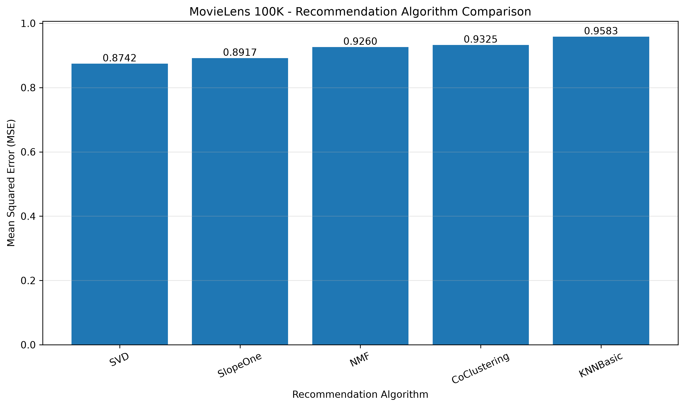
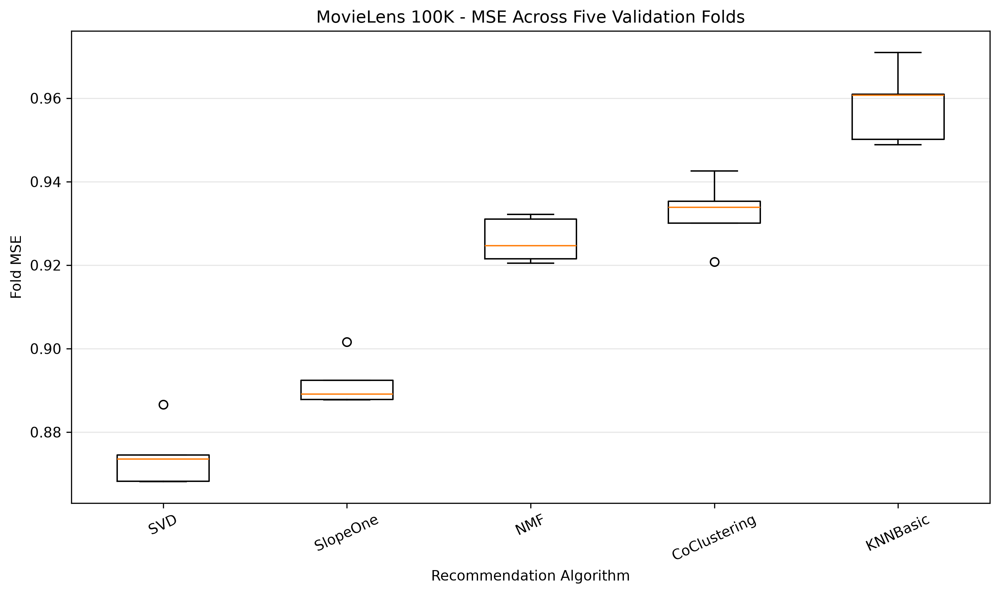

# Building a Recommendation System with SURPRISE — MovieLens 100K

**UC Berkeley Professional Certificate in Machine Learning & Artificial Intelligence — Module 19, Required Discussion 19.1**  
**Status:** Completed — five algorithms evaluated using five-fold cross-validation.  
**Best model:** **SVD**, mean cross-validation **MSE = 0.8742**.

> **Executive summary:** Using the original MovieLens 100K dataset, SVD achieved the lowest average MSE (0.8742), followed by SlopeOne (0.8917), NMF (0.9260), CoClustering (0.9325), and KNNBasic (0.9583). The results measure held-out rating prediction accuracy, not top-N recommendation quality.

## Project objective

Compare five collaborative-filtering algorithms with the same seeded five-fold cross-validation procedure and select the algorithm with the lowest mean squared error (MSE) for predicting movie ratings.

## Dataset

- **Source:** [GroupLens MovieLens 100K](https://grouplens.org/datasets/movielens/)
- **100,000** ratings, **943** users, **1,682** movies
- **Rating scale:** 1–5 stars
- **Input:** `data/ml-100k/u.data` (tab-separated user ID, item ID, rating, timestamp)
- **Modeling fields:** user ID, item ID, rating; timestamp is not used for prediction.

The notebook reads the dataset **locally**; it does not rely on the SURPRISE automatic dataset downloader. The dataset files are present in this GitHub project under `data/ml-100k/`. Consult GroupLens usage terms when redistributing data.

## Methods

- **Algorithms:** KNNBasic, SVD, NMF, SlopeOne, CoClustering
- **Validation:** Five shuffled folds with `random_state=42`, shared across algorithms
- **Primary metric:** Mean MSE, calculated by averaging the five fold-level squared RMSE values
- **Additional metrics:** Mean RMSE, mean MAE, standard deviation of fold MSE, and average fit time
- **Model selection:** Lowest mean MSE; no hyperparameter tuning in this baseline comparison

## Cross-validation results

| Rank | Algorithm | Mean MSE ↓ | Std MSE | Mean RMSE | Mean MAE | Mean fit time (s) |
|---:|---|---:|---:|---:|---:|---:|
| 1 | **SVD** | **0.8742** | 0.0075 | 0.9350 | 0.7372 | 0.403 |
| 2 | SlopeOne | **0.8917** | 0.0058 | 0.9443 | 0.7422 | 0.196 |
| 3 | NMF | **0.9260** | 0.0054 | 0.9623 | 0.7565 | 0.550 |
| 4 | CoClustering | **0.9325** | 0.0080 | 0.9657 | 0.7559 | 0.432 |
| 5 | KNNBasic | **0.9583** | 0.0091 | 0.9789 | 0.7735 | 0.064 |

**Finding:** SVD achieved the lowest average MSE, **0.8742**. Compared with KNNBasic (0.9583), SVD's mean MSE was approximately **8.8% lower**. SlopeOne ranked second with an MSE of **0.8917**. These comparisons apply to the tested dataset, folds, and model configurations.

## Visualizations

### Mean MSE by algorithm



The bar chart ranks the five algorithms by average cross-validation MSE (lower is better).

### MSE distribution across folds



The box plot illustrates variation in fold-level MSE for each algorithm. SVD shows consistently low errors relative to the alternatives in this experiment.

## Project structure

```text
Module_19/Assignment_19_1_SURPRISE_Recommendation_System/
├── README.md
├── requirements.txt
├── data/
│   ├── README.md
│   └── ml-100k/
│       └── u.data                      # plus other MovieLens dataset files
├── notebooks/
│   └── discussion19_1_completed.ipynb
├── outputs/
│   ├── figures/
│   │   ├── model_comparison.png
│   │   └── cross_validation_mse.png
│   └── reports/
│       ├── cross_validation_summary.csv
│       ├── cross_validation_folds.csv
│       └── discussion_post.txt
└── Execution_Screenshots/
    ├── README.md
    ├── jupyter_notebook_execution_1.png
    └── jupyter_notebook_execution_2.png
```

## Reproduce the analysis

1. Use Python 3.11 (or a compatible environment with `scikit-surprise` installed).
2. Install dependencies from the project root: `pip install -r requirements.txt`.
3. Verify that `data/ml-100k/u.data` exists.
4. Launch Jupyter from the project root or the `notebooks/` folder and open `notebooks/discussion19_1_completed.ipynb`.
5. Run the cells in order. The notebook evaluates all five models, saves the CSV reports, generates both figures, and writes the expanded discussion text.
6. Review `outputs/reports/cross_validation_summary.csv` and the notebook output for the winning model.

**Note:** Jupyter's working directory determines relative paths. The notebook contains project-root detection for loading the local data.

## Deliverables

- [Executed notebook](notebooks/discussion19_1_completed.ipynb)
- [Mean MSE comparison chart](outputs/figures/model_comparison.png)
- [Cross-validation MSE box plot](outputs/figures/cross_validation_mse.png)
- [Summary metrics (CSV)](outputs/reports/cross_validation_summary.csv)
- [Per-fold metrics (CSV)](outputs/reports/cross_validation_folds.csv)
- [Expanded discussion text](outputs/reports/discussion_post.txt)
- [Execution screenshots](Execution_Screenshots/)

## Limitations and next steps

- Shuffled rating cross-validation does not test future-time prediction or cold-start performance.
- MSE, RMSE, and MAE evaluate rating prediction, not ranking quality, diversity, fairness, or customer satisfaction.
- These results compare baseline configurations; hyperparameter tuning could change the ranking.
- Future work: tune model hyperparameters and evaluate top-N precision/recall.

## Course submission

The discussion instructions specify an **initial post of no more than 200 words** and **at least two peer replies, each no more than 150 words**. The longer narrative is suitable for project documentation, but should be shortened for a strictly compliant discussion-board post.

**Project link:** https://github.com/trilokreddyarava/Trilok_Berkley_AI_ML_PC/tree/main/Module_19/Assignment_19_1_SURPRISE_Recommendation_System
