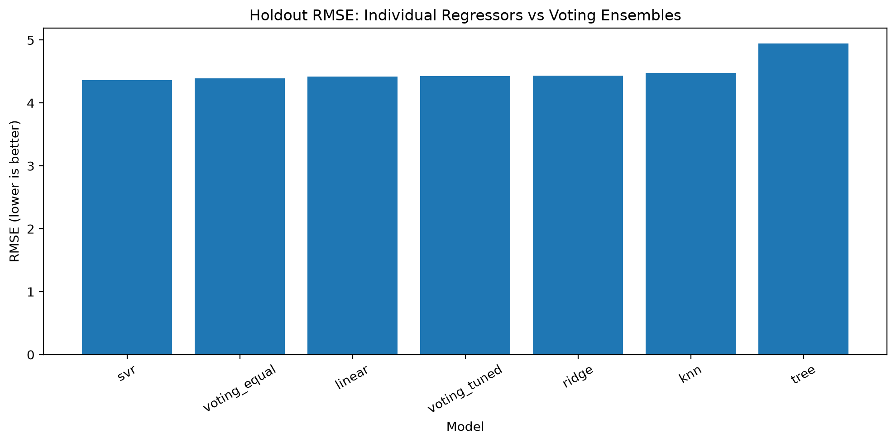
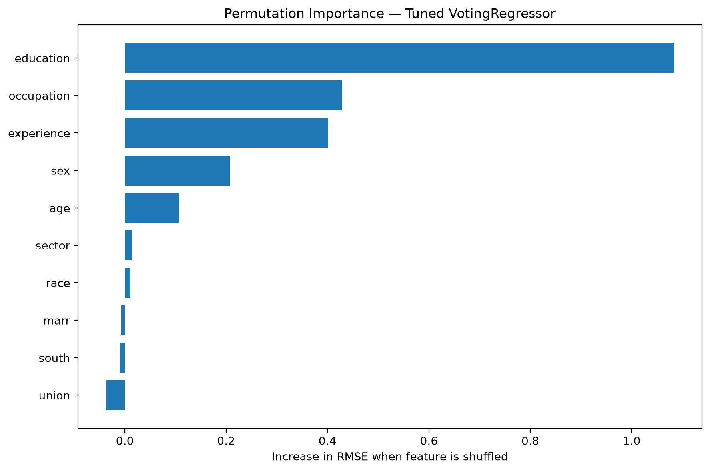

# Module 20 — Required Try-It Activity 20.1
## Comparing Aggregating Models for Regression with VotingRegressor

**Program:** UC Berkeley Professional Certificate in Machine Learning and Artificial Intelligence  
**Task:** Predict hourly wages and determine whether a voting ensemble improves upon individual regression models.  
**Dataset:** OpenML Wage dataset, ID 534.

## 1. Project objective

This project compares five individual regression estimators against two `VotingRegressor` ensembles to answer:

1. Does combining regressors (“wisdom of the crowd”) improve held-out prediction accuracy?
2. Does cross-validated tuning improve the voting ensemble?
3. How interpretable is the ensemble, and which features matter most when predicting wages?

## 2. Dataset

The OpenML wage dataset (ID 534) contains **534 observations**, **10 input features**, and one target (`WAGE`, hourly wages). The features used are education, occupation, experience, sex, age, sector, race, marital status (`marr`), region (`south`), and union membership. The notebook normalizes column names to lowercase to handle the original uppercase target name.

The dataset is fetched from OpenML by the notebook, so a local dataset CSV is not required. An internet connection may be needed on the first run.

## 3. Methodology

- Split data into training and held-out test sets (**80/20**, `random_state=42` in the provided notebook).
- Use a preprocessing pipeline with numeric imputation and scaling, and categorical imputation and one-hot encoding.
- Fit five baseline estimators: `LinearRegression`, `KNeighborsRegressor`, `DecisionTreeRegressor`, `Ridge`, and `SVR`.
- Evaluate an **equal-weight VotingRegressor** and a **tuned VotingRegressor**.
- Use `RandomizedSearchCV` and **3-fold cross-validation** on training data to tune ensemble weights and selected model hyperparameters.
- Evaluate the models on the held-out test set using **RMSE**, **MAE**, and **R²**.
- Use **permutation feature importance** to assess the tuned ensemble’s reliance on the original features.

**Metric interpretation:** Lower RMSE/MAE is better; higher R² is better.

## 4. Results — Held-out test set

| Rank | Model | RMSE ↓ | MAE ↓ | R² ↑ |
|---:|---|---:|---:|---:|
| 1 | **Support Vector Regression (SVR)** | **4.3604** | **2.9226** | **0.4036** |
| 2 | VotingRegressor — equal weights | 4.3880 | 3.1019 | 0.3960 |
| 3 | Linear Regression | 4.4162 | 3.2132 | 0.3882 |
| 4 | VotingRegressor — tuned | 4.4250 | 3.2059 | 0.3858 |
| 5 | Ridge | 4.4361 | 3.2498 | 0.3827 |
| 6 | K-Nearest Neighbors | 4.4753 | 3.2129 | 0.3717 |
| 7 | Decision Tree | 4.9460 | 3.5370 | 0.2326 |

*Values reproduced from `outputs/reports/model_comparison.csv`.*

### Did the ensemble outperform the individual models?

**No.** SVR achieved the lowest held-out RMSE (**4.3604**). The best ensemble was the equal-weight VotingRegressor (**4.3880**), an RMSE difference of approximately **0.0276**. The tuned ensemble scored **4.4250**, which was also worse than equal-weight voting on the holdout set. Tuning on cross-validation folds does not guarantee a better result on a single held-out test set. The small difference between SVR and equal-weight voting should not be treated as statistically significant without further testing.



*Figure 1. Test RMSE across individual regressors and the two voting ensembles; lower is better.*

## 5. Interpretability and permutation importance

A `VotingRegressor` averages predictions from several estimators, so it does not provide one unified set of regression coefficients. Permutation importance estimates the effect on test RMSE when a feature is shuffled: a larger positive RMSE increase indicates the model relied more heavily on that feature.

| Rank | Feature | Increase in RMSE when shuffled |
|---:|---|---:|
| 1 | **Education** | **1.0828** |
| 2 | **Occupation** | **0.4282** |
| 3 | **Experience** | **0.4006** |
| 4 | Sex | 0.2070 |
| 5 | Age | 0.1068 |

*Values reproduced from `outputs/reports/permutation_feature_importance.csv`.*



*Figure 2. Permutation feature importance for the tuned voting ensemble.*

**Interpretation:** Education, occupation, and experience were the strongest predictors in this experiment. These are **predictive associations, not causal effects**. Permutation importance can be affected by correlated predictors, test-set size, and randomness. Because demographic attributes are present, any real-world application would require additional fairness and bias assessment.

## 6. Conclusions

- **Best model:** SVR, with test RMSE **4.3604**, MAE **2.9226**, and R² **0.4036**.
- **Best ensemble:** Equal-weight VotingRegressor, with RMSE **4.3880**.
- **Tuning outcome:** The tuned ensemble did **not** improve held-out RMSE compared with equal weights.
- **Main insight:** Ensemble learning is not guaranteed to outperform a strong individual model.
- **Most important features:** Education, occupation, and experience.

Potential follow-up work includes repeated cross-validation or multiple holdout splits, additional tuning of individual models, and more robust interpretability and fairness checks.

## 7. Suggested repository layout

```text
Module_20/
└── Assignment_20_1_VotingRegressor/
    ├── README.md
    ├── notebooks/
    │   └── Module20_20_1_VotingRegressor_Completed.ipynb
    ├── outputs/
    │   ├── figures/
    │   │   ├── model_comparison.png
    │   │   └── feature_importance.png
    │   └── reports/
    │       ├── model_comparison.csv
    │       ├── voting_tuning_cv_results.csv
    │       ├── permutation_feature_importance.csv
    │       └── discussion_post.txt
    └── docs/
        └── Module20_1_Expanded_Discussion_Submission.docx
```

The paths above are **recommended GitHub paths**. Place the corresponding files in these folders before uploading so that the relative image links render correctly. Keep only one file named `model_comparison.png` in the `outputs/figures` directory.

## 8. Reproducing the analysis

1. Create a Python environment with `numpy`, `pandas`, `matplotlib`, `scikit-learn`, `scipy`, `joblib`, `jupyter`, and `openml` support through scikit-learn's `fetch_openml`.
2. Open `notebooks/Module20_20_1_VotingRegressor_Completed.ipynb` in Jupyter Notebook or JupyterLab.
3. Choose **Restart Kernel and Run All Cells**.
4. Wait for the cross-validated tuning and permutation importance steps to complete.
5. Verify that both figures and the three CSV reports appear in `outputs/`.
6. **Save the notebook with its executed outputs** before committing it to GitHub.

> **Note:** The notebook may use paths relative to its current working directory. If output files are written into `notebooks/outputs/`, either run it from the project root or move those files into the repository layout shown above and adjust the output path accordingly.

## 9. Assignment discussion requirements

The initial discussion post must be **no more than 200 words**. The activity also requires **two peer replies, each no more than 150 words**. This README and the optional detailed report are supporting project documentation, not substitutes for the discussion post.

## 10. Source and tools

- **Data:** OpenML dataset 534, accessed using `sklearn.datasets.fetch_openml`.
- **Models and evaluation:** scikit-learn (`VotingRegressor`, `RandomizedSearchCV`, regression estimators, permutation importance).
- **Analysis:** Python, pandas, NumPy, and Matplotlib.

*Results are specific to the executed notebook's split, preprocessing, and model configurations.*
