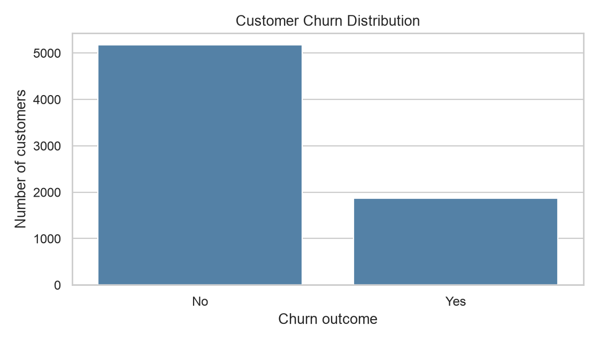
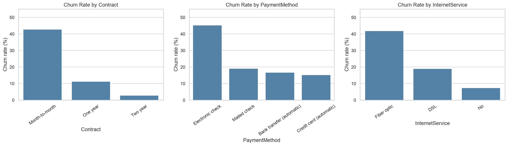
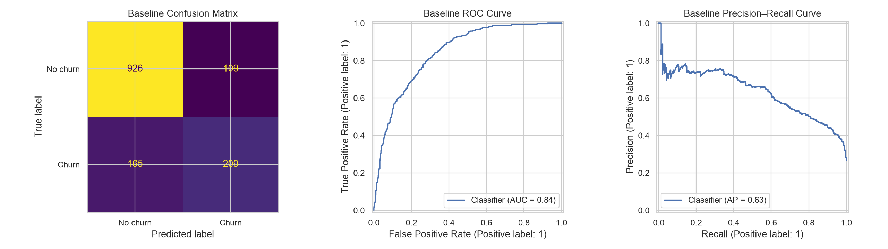

### Predicting Subscription Renewal Risk and Customer Churn Using Machine Learning

**Author:** Trilok Reddy Arava  
**Assignment:** UC Berkeley Professional Certificate in Machine Learning and Artificial Intelligence — Required Capstone Assignment 20.1

#### Table of Contents
- [Executive summary](#executive-summary)
- [Rationale](#rationale)
- [Research Question](#research-question)
- [Data Sources](#data-sources)
- [Methodology](#methodology)
  - [Baseline Machine Learning Model: Logistic Regression (Module 20.1)](#baseline-machine-learning-model-logistic-regression-module-201)
- [Results](#results)
- [Next steps](#next-steps)
- [Outline of project](#outline-of-project)
- [Contact and Further Information](#contact-and-further-information)

#### Executive summary
This project examines whether customer, subscription, and billing characteristics can identify customers at elevated risk of churn. Using **7,043** records from the IBM Telco Customer Churn dataset, exploratory analysis found an overall churn rate of **26.54%**. An interpretable Logistic Regression baseline achieved **80.55% accuracy**, **55.88% churn recall**, and **0.8419 ROC-AUC** on a held-out test set. The findings are intended to inform retention prioritization, not automate customer decisions.

#### Rationale
Subscription businesses depend on recurring relationships. Earlier identification of at-risk customers could help customer success and renewal teams target outreach, evaluate onboarding, and manage limited retention resources. Missing an actual churner can mean lost recurring revenue, while contacting a customer who would not churn consumes time and budget.

#### Research Question
**Can machine learning identify subscription-based customers at greatest risk of churn and explain the factors associated with that risk, enabling businesses to prioritize retention efforts and improve renewal outcomes?**

#### Data Sources
The **IBM Telco Customer Churn dataset** (`data/Telco-Customer-Churn.csv`) contains 7,043 customer records and 21 original columns. Fields include tenure, contract type, subscribed services, monthly and total charges, payment method, and the binary target `Churn` (`Yes`/`No`). The public dataset is a **telecom churn proxy**; it does **not** contain Salesforce renewal opportunities, Closed Won/Closed Lost outcomes, or verified SaaS renewals. No company-confidential data is used.

#### Methodology
The project follows **CRISP-DM** as its overall analytical framework. For **Module 20.1, Logistic Regression is the single baseline machine learning algorithm implemented and evaluated**; additional classifiers are reserved for Module 24:
1. **Business and data understanding:** define the renewal-risk research question, examine schema, data types, and churn class balance.
2. **Cleaning:** check duplicates and missing values; convert `TotalCharges` to numeric (11 blank values); preserve records and impute missing values within a training-only pipeline; review numerical outliers using IQR.
3. **Feature engineering:** construct tenure groups, monthly-charge bands, and count subscribed add-on services.
4. **EDA:** compare churn rates across contract, payment method, and internet-service segments; visualize numerical distributions, box plots, correlations, and engineered features.
5. **Baseline modeling — Logistic Regression (Module 20.1):** train and evaluate an interpretable binary **Logistic Regression classifier** using a stratified 80/20 train/test split (`random_state=42`), training-only median/mode imputation, scaling and one-hot encoding, and Logistic Regression with default 0.50 classification threshold. Evaluate precision, recall, F1, accuracy, ROC-AUC, average precision, confusion matrix, ROC and precision–recall curves. Model comparison and tuning are planned for Module 24.

##### Baseline Machine Learning Model: Logistic Regression (Module 20.1)

**Selected algorithm: Logistic Regression — binary classification.** This is the **only machine learning model trained and evaluated for the Module 20.1 capstone**, consistent with the assignment requirement to establish one baseline for comparison in Module 24. The model predicts whether a customer will churn (`Churn = Yes`) using customer, contract, billing, and service characteristics.

- **Why Logistic Regression?** It is an interpretable classification baseline that estimates churn probabilities and supports examination of feature associations.
- **Training approach:** Stratified 80% training / 20% test split (`random_state=42`), with missing-value imputation, numerical scaling, and categorical one-hot encoding applied through a preprocessing pipeline fitted on training data only.
- **Prediction threshold:** 0.50 for the initial baseline.
- **Evaluation:** Accuracy, churn precision, churn recall, F1-score, ROC-AUC, average precision, and confusion matrix. Churn recall is emphasized because failing to flag an at-risk customer may mean a missed retention opportunity.
- **Module 24 comparison:** This Logistic Regression baseline will be compared against additional classifiers, including Decision Tree and Random Forest, with cross-validation and hyperparameter tuning.

**Baseline test-set performance:** **80.55% accuracy · 55.88% churn recall · 0.8419 ROC-AUC**. The complete metrics table appears in the Results section below.

#### Results
**Data quality:** 7,043 records; 0 duplicate customer IDs; 11 blank `TotalCharges` values after numeric conversion.

**EDA observations:**
- Overall churn: **1,869 / 7,043 = 26.54%**.
- **Contract:** month-to-month **42.71%** churn; one-year **11.27%**; two-year **2.83%**.
- **Payment method:** electronic check **45.29%** churn; automatic credit card **15.24%**.
- **Internet service:** fiber optic **41.89%** churn; DSL **18.96%**; no internet service **7.40%**.

**Logistic Regression baseline — held-out test set (1,409 customers):**

| Metric | Value |
|---|---:|
| Accuracy | 0.8055 |
| Precision (churn) | 0.6572 |
| Recall (churn) | 0.5588 |
| F1-score (churn) | 0.6040 |
| ROC-AUC | 0.8419 |
| Average precision | 0.6334 |

**Interpretation:** Recall is particularly relevant because missing customers who will churn may prevent timely outreach. At the default threshold, the model detects about 55.9% of actual churners. Precision helps quantify the cost of unnecessary outreach. ROC-AUC measures ranking discrimination across thresholds. These are initial results, not deployment guarantees. Segment-level differences are **observational associations, not causal effects**.

#### Next steps
For Module 24, compare Decision Tree, Random Forest, and other suitable classifiers using stratified cross-validation and GridSearchCV on training data. Assess threshold selection, precision–recall tradeoffs, calibration and segment stability. Develop a nontechnical retention playbook and propose a controlled pilot to validate intervention effectiveness, outreach costs, fairness, privacy, and consent. Future work with authorized CRM records would be needed to validate actual SaaS renewal outcomes.

#### Outline of project
**Project folders:**
- [Execution screenshots](Execution_Screenshots/)
- [Dataset folder](data/)
- [Jupyter notebooks folder](notebooks/)
- [Generated outputs folder](outputs/)
- [Visualization figures](outputs/figures/)
- [CSV reports](outputs/reports/)

**Project files:**
- [Executed Jupyter notebook — EDA and Logistic Regression baseline](notebooks/Capstone_20_1_EDA_Baseline.ipynb)
- [Source dataset](data/Telco-Customer-Churn.csv)
- [EDA charts](outputs/figures/)
- [Baseline evaluation metrics](outputs/reports/baseline_metrics.csv)
- [Outlier audit](outputs/reports/outlier_audit.csv)
- [Model coefficient report](outputs/reports/baseline_coefficients.csv)

##### Contact and Further Information
For additional details, see the linked Jupyter notebook and this repository's project documentation.

**Reproduce:** Install `pandas`, `numpy`, `matplotlib`, `seaborn`, `scikit-learn`, `jupyter`, then run the notebook from the `notebooks/` folder or project root. The CSV is provided in `data/`.
