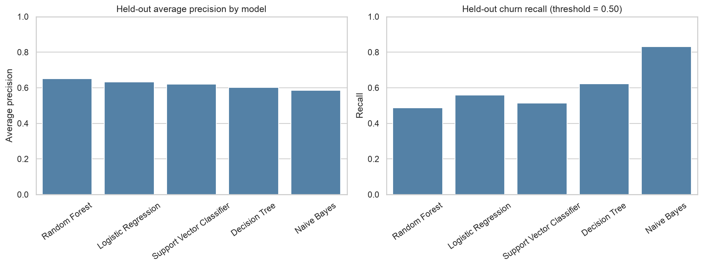
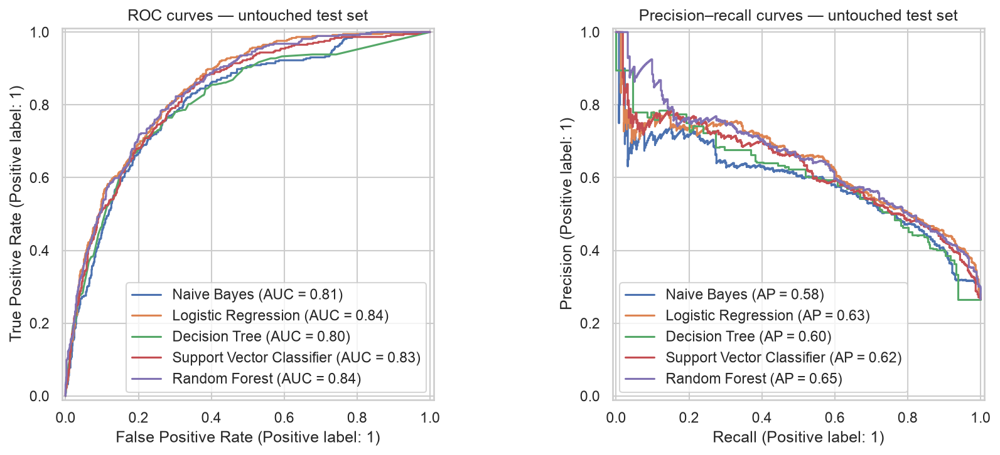

# Predicting Subscription Renewal Risk and Customer Churn Using Machine Learning

**Author:** Trilok Reddy Arava  
**Program:** UC Berkeley Professional Certificate in Machine Learning and Artificial Intelligence  
**Assignment:** Final Capstone 24.1 (extending Module 20.1)

## Table of contents

- [Executive Summary](#executive-summary)
- [Project Overview](#project-overview)
- [Start Here — Only Two Notebooks](#start-here--only-two-notebooks)
- [Reports for Two Audiences](#reports-for-two-audiences)
- [Research Question](#research-question)
- [Key Findings](#key-findings)
- [Model Performance Comparison](#model-performance-comparison)
- [Visual Results](#visual-results)
- [Data and Reproducibility](#data-and-reproducibility)
- [Limitations and Future Work](#limitations-and-future-work)
- [Local execution verification](#local-execution-verification)
- [Repository contents](#repository-contents)
- [Project files and output navigation](#project-files-and-output-navigation)
  - [Notebooks and documentation](#notebooks-and-documentation)
  - [Reports](#reports)
  - [Figures](#figures)
  - [Execution screenshots](#execution-screenshots)

## Executive Summary

This capstone analyzes **7,043 customers** in the public IBM Telco Customer Churn dataset to assess whether machine learning can help prioritize customers at risk of leaving. The observed churn rate was **26.54%**. Five classification algorithms were compared using **stratified three-fold cross-validation average precision on the training data**, with a separate 1,409-customer test set reserved for final evaluation.

**Key result:** Logistic Regression was selected based on the highest training cross-validation average precision (**0.6602**). On the held-out test set, it achieved **80.55% accuracy**, **55.88% churn recall**, **0.8419 ROC-AUC**, and **0.6334 average precision**. At a 0.50 decision threshold, it correctly identified **209 of 374 churners**, while missing 165 and flagging 109 non-churners. The model is a potential *risk-ranking aid*, not proof that any retention action will work.

**Business implication:** A controlled outreach pilot, with privacy review and measurement of actual retention outcomes, would be needed before operational deployment. The historical telecom dataset is a proxy for subscription churn, not real SaaS renewal data. For details, see the [technical report](README_TECHNICAL.md) and [business-facing report](README_NON_TECHNICAL.md).

## Project Overview

This capstone uses the public IBM Telco Customer Churn dataset (**7,043 customer records; 26.54% churn**) to predict which customers are at risk of leaving. It follows the two-notebook progression of the supplied Berkeley sample: **first prepare data, train and compare models; then evaluate and interpret the selected model.** This is an educational telecom dataset used as a proxy for subscription renewal risk, not actual Salesforce or SaaS renewal records.

## Start Here — Only Two Notebooks

1. **[Notebook 01 — Subscription Churn Prediction](notebooks/Subscription_Churn_Prediction.ipynb)**: Goal, Data Problem, Expected Results, Executive Summary, Business Rationale, Research Question, Data Overview, EDA, Data Setup, Preprocessing, original Module 20 Logistic Regression baseline, **Model Training, Hyperparameter Tuning, and Comparison** (retained original code), and Best Model Selection. Trains **Naive Bayes, Logistic Regression, Decision Tree, SVC, and Random Forest**.
2. **[Notebook 02 — Subscription Churn Evaluation](notebooks/Subscription_Churn_Evaluation.ipynb)**: Essential data setup, final selected Logistic Regression model statistics, confusion matrix, individual customer predictions, global feature importance, coefficients, local sensitivity explanations, business implications, conclusions, and future work.

**Run Notebook 01 first, then Notebook 02.** Notebook 01 writes fitted models to `outputs/models/`, comparison files to `outputs/reports/`, and figures to `outputs/figures/`; Notebook 02 loads the saved artifacts and generates final evaluation reports. The final submission uses only these two notebooks.

## Reports for Two Audiences

- **[Technical README](README_TECHNICAL.md)** — methodology, preprocessing, model selection, validation, metrics, interpretation, and reproducibility.
- **[Nontechnical README](README_NON_TECHNICAL.md)** — business question, executive summary, findings, retention implications, limitations, and recommendations.

## Research Question

**Can machine learning identify subscription-based customers at greatest risk of churn and explain the factors associated with that risk, enabling businesses to prioritize retention efforts and improve renewal outcomes?**

## Key Findings

The selected Logistic Regression model achieved **80.55% accuracy, 55.88% churn recall, and 0.8419 ROC-AUC** on the 1,409-customer held-out set. The five-model comparison uses **three-fold stratified cross-validation average precision on training data** for model selection. Logistic Regression was selected using training-only cross-validation, before inspecting held-out test results. Observed patterns and coefficients are associations, **not causal evidence** that any specific intervention prevents churn.

## Model Performance Comparison

Models were **selected using training-only cross-validation average precision (CV AP)**; test metrics below are for evaluation, not retrospective model selection. Recall is for the churn class at a 0.50 threshold.

| Model | Training CV AP | Test accuracy | Test churn recall | Test ROC-AUC | Test AP |
|---|---:|---:|---:|---:|---:|
| **Logistic Regression (selected)** | **0.6602** | **80.55%** | 55.88% | **0.8419** | 0.6334 |
| Random Forest | 0.6531 | 79.99% | 48.66% | 0.8394 | **0.6502** |
| Support Vector Classifier | 0.6494 | 79.49% | 51.34% | 0.8266 | 0.6211 |
| Naive Bayes | 0.6134 | 69.27% | **83.16%** | 0.8070 | 0.5846 |
| Decision Tree | 0.5909 | 77.93% | 62.30% | 0.8048 | 0.6026 |

**Interpretation:** Naive Bayes has the highest test recall but produces more false positives. Random Forest has the highest *test* AP, but that was not the predetermined selection metric. The selected Logistic Regression model has the highest *training CV* AP. These differences do not establish statistically significant superiority.

## Visual Results

### Model comparison



### ROC and precision–recall curves



The figures are generated by the project notebooks. See the [complete figure index](#figures), [report index](#reports), and [execution screenshots](#execution-screenshots).

## Data and Reproducibility

- Dataset: [`data/Telco-Customer-Churn.csv`](data/Telco-Customer-Churn.csv)
- Python dependencies: [`requirements.txt`](requirements.txt)
- Utility: [`capstone_utils.py`](capstone_utils.py)
- Outputs: `outputs/figures/` and `outputs/reports/`
- Data cleaning includes numeric conversion of `TotalCharges`, imputation inside model pipelines, and exclusion of customer IDs.
- Split: 80% training / 20% test, stratified by churn, `random_state=42`.

From the project root:

```bash
python -m pip install -r requirements.txt
jupyter notebook
```

Open and run the notebooks in the numbered order above. **Do not use the holdout test set to choose a model or tune a deployment threshold.**

## Limitations and Future Work

The source is historical telecom data, not real software renewals. Future work should test external and temporal generalization, calibration, fairness, operational thresholds, and the causal impact of outreach through controlled pilots.

## Local execution verification

Both notebooks were restarted and executed from top to bottom in the author’s local Jupyter environment without reported errors. The six key dataset, utility, and report dependencies were checked and found. This is a **local execution check**, not an independent clean-room reproduction. Run Notebook 01 before Notebook 02 when regenerating the artifacts.

## Repository contents

- `notebooks/`: final prediction/training and evaluation notebooks
- `data/`: public telecom churn dataset
- `outputs/figures/`: generated plots
- `outputs/reports/`: evaluation, quality, and model-comparison reports
- `outputs/models/`: fitted model artifacts (if included in the uploaded repository)
- `Execution_Screenshots/`: evidence of local notebook execution
- `capstone_utils.py`: shared helper functions
- `requirements.txt`: Python dependencies

The `__pycache__/` directory contains automatically generated Python bytecode and is not needed for reproducibility.

## Project files and output navigation

### Notebooks and documentation

| Resource | Link |
|---|---|
| Prediction, preprocessing, model training and selection | [Notebook 01 — Subscription Churn Prediction](notebooks/Subscription_Churn_Prediction.ipynb) |
| Held-out evaluation, interpretation and business findings | [Notebook 02 — Subscription Churn Evaluation](notebooks/Subscription_Churn_Evaluation.ipynb) |
| Main project guide | [README.md](README.md) |
| Technical methodology | [README_TECHNICAL.md](README_TECHNICAL.md) |
| Business-facing findings | [README_NON_TECHNICAL.md](README_NON_TECHNICAL.md) |
| Source dataset | [Telco Customer Churn CSV](data/Telco-Customer-Churn.csv) |
| Dependencies | [requirements.txt](requirements.txt) |
| Shared utilities | [capstone_utils.py](capstone_utils.py) |

### Reports

| Area | Files |
|---|---|
| Data audit | [Data dictionary](outputs/reports/data_dictionary.csv) · [Data quality summary](outputs/reports/data_quality_summary.csv) · [Outlier audit](outputs/reports/outlier_audit.csv) |
| Baseline | [Baseline metrics](outputs/reports/baseline_metrics.csv) · [Baseline coefficients](outputs/reports/baseline_coefficients.csv) |
| Model selection | [Cross-validation results](outputs/reports/cross_validation_results.csv) · [Final model comparison](outputs/reports/final_model_comparison.csv) · [Selected model](outputs/reports/selected_model.txt) |
| Test predictions | [Test predictions](outputs/reports/test_predictions.csv) |
| Interpretation | [Permutation importance](outputs/reports/final_permutation_importance.csv) · [Logistic Regression coefficients](outputs/reports/selected_logistic_regression_coefficients.csv) |
| Illustrative diagnostics | [Threshold trade-offs](outputs/reports/illustrative_threshold_tradeoffs.csv) · [Customer risk examples](outputs/reports/illustrative_customer_risk_examples.csv) · [Top-decile risk](outputs/reports/illustrative_top_decile_risk_report.csv) · [Local sensitivity](outputs/reports/illustrative_local_sensitivity.csv) |

### Figures

| Figure | Link |
|---|---|
| 01 · Churn distribution | [View figure](outputs/figures/01_churn_distribution.png) |
| 02 · Categorical churn rates | [View figure](outputs/figures/02_categorical_churn_rates.png) |
| 03 · Numeric distributions | [View figure](outputs/figures/03_numeric_distributions.png) |
| 04 · Numeric correlations | [View figure](outputs/figures/04_numeric_correlations.png) |
| 05 · Engineered features | [View figure](outputs/figures/05_engineered_features.png) |
| 06 · Baseline evaluation | [View figure](outputs/figures/06_baseline_evaluation.png) |
| 07 · Model coefficients | [View figure](outputs/figures/07_model_coefficients.png) |
| 08 · Model comparison | [View figure](outputs/figures/08_model_comparison.png) |
| 09 · ROC and precision–recall comparison | [View figure](outputs/figures/09_roc_pr_comparison.png) |
| 10 · Confusion matrices | [View figure](outputs/figures/10_confusion_matrices.png) |
| 11 · Threshold trade-off | [View figure](outputs/figures/11_threshold_tradeoff.png) |
| 12 · Final feature importance | [View figure](outputs/figures/12_final_feature_importance.png) |
| Selected model confusion matrix | [View figure](outputs/figures/final_selected_model_confusion_matrix.png) |
| Selected Logistic Regression coefficients | [View figure](outputs/figures/selected_logistic_regression_coefficients.png) |

### Execution screenshots

These screenshots document the author's successful local notebook execution; they are not a substitute for reproducing the environment.

| Notebook | Screenshots |
|---|---|
| Notebook 01 — Prediction | [Execution screenshot 1](Execution_Screenshots/jupyter_notebook1_execution_1.png) · [Execution screenshot 2](Execution_Screenshots/jupyter_notebook1_execution_2.png) |
| Notebook 02 — Evaluation | [Execution screenshot 1](Execution_Screenshots/jupyter_notebook2_execution_1.png) · [Execution screenshot 2](Execution_Screenshots/jupyter_notebook2_execution_2.png) |

> **Link verification:** Relative paths follow the documented repository layout. Some matching generated artifacts were available for local filename checks, but the full GitHub directory tree was not supplied. Verify all links on the live GitHub repository before submission; local upload suffixes such as `(3)` do not establish GitHub filenames.
