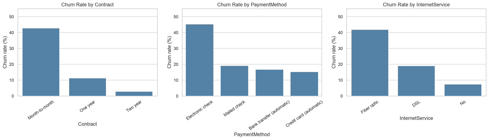
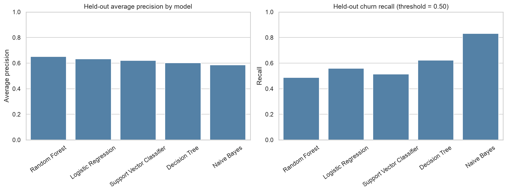

# Predicting Subscription Renewal Risk and Customer Churn Using Machine Learning

**Nontechnical Capstone Report | UC Berkeley Professional Certificate in Machine Learning and Artificial Intelligence — Capstone 24.1**  
**Author:** Trilok Reddy Arava

[Main project README](README.md) · [Technical report](README_TECHNICAL.md) · [Project notebooks](#outline-of-project)

## Executive summary

### Project overview and goals

Subscription businesses need to know which customers may cancel so they can offer timely, relevant support. I analyzed **7,043 customers** from the public IBM Telco Customer Churn dataset and compared five machine-learning approaches to identify customers at higher risk of leaving. This is an educational study using telecom data, **not** proprietary SaaS or Salesforce renewal records.

### Findings

**26.54%** of customers in the dataset churned. Churn was more common among customers on **month-to-month contracts (42.71%)**, those using **electronic checks (45.29%)**, and those with **fiber-optic internet service (41.89%)**. These patterns show associations, not proof of why a customer canceled.

### Results and conclusion

The project compared **Naive Bayes, Logistic Regression, Decision Tree, Support Vector Classifier, and Random Forest**. **Logistic Regression** was selected because it achieved the best score on the model-selection measure applied during training. On a separate test group of **1,409 customers**, it achieved **80.55% accuracy** and identified **209 of the 374** customers who actually churned. It missed **165 churners** and incorrectly flagged **109** customers who stayed. This illustrates why prediction accuracy alone is not enough.

Naive Bayes identified more churners at the standard cutoff, but it also produced many more false alarms. Random Forest was competitive. There is no evidence from this dataset that contacting customers, offering discounts, or changing contract terms would itself prevent churn.

### Future research and development

Test the approach on more recent and appropriately authorized subscription-renewal data. Study whether predicted risk remains reliable across customer segments and over time, and whether probability estimates accurately reflect observed churn rates.

### Next steps and recommendations

1. **Pilot targeted outreach** with a limited group of high-risk customers, rather than contacting everyone.
2. **Investigate underlying customer needs**, including onboarding, service quality, and billing experience.
3. **Test what works** using a randomized comparison between outreach and business-as-usual groups.
4. **Measure business outcomes**, including actual retained customers, outreach cost, and customer experience—not model accuracy alone.
5. **Review privacy and fairness** before using any customer-level prediction operationally.

## Rationale

Keeping existing customers can support recurring revenue, but customer-success teams have limited time. A risk-ranking model could help prioritize investigation and support while avoiding unnecessary outreach.

## Research Question

**Can machine learning identify customers at greater risk of churn and highlight patterns that could help prioritize retention outreach?**

## Data Sources

The project uses the public **IBM Telco Customer Churn** dataset: 7,043 customer records with information about contract type, tenure, billing, internet service, and other subscriptions. The outcome is whether each customer churned. [Dataset](data/Telco-Customer-Churn.csv).

### Exploratory data analysis

The analysis compared churn patterns across customer segments and reviewed tenure, monthly charges, and other customer characteristics. These charts help identify groups worth further investigation:

### Cleaning and preparation

Customer records were checked for quality issues. Blank total-charge values were handled, and customer identifiers were excluded from prediction.

### Preprocessing

Customer characteristics were prepared consistently for model comparison. Details are in the [technical report](README_TECHNICAL.md).

### Final Dataset

The same 7,043 customers were divided into training and testing groups. The separate test group contained **1,409 customers** and was held aside while the models were developed.

## Methodology

Five approaches were compared using the same underlying customer data. Models were selected using training-data validation, then evaluated on the separate test group.

### Naive Bayes Model

A simple probability-based model. It identified **83.16%** of actual churners in the test group, but its lower precision means more unnecessary outreach if used at the standard cutoff.

### Logistic Regression Model

The original Module 20 baseline and the **selected model**. Test accuracy was **80.55%**, with **55.88% churn recall**. It balances competitive prediction quality with relatively straightforward interpretation.

### Decision Tree Model

A rule-based model that can express customer patterns in understandable splits. It identified **62.30%** of churners in the test group but was less accurate overall than Logistic Regression.

### Support Vector Classifier Model

A model that separates customers into predicted risk groups using patterns in their characteristics. It achieved **79.56%** test accuracy and **51.60%** churn recall.

### Random Forest Model

A collection of decision trees used together. It achieved **80.06%** test accuracy and **48.93%** churn recall. Its overall ranking performance was competitive, but the training-only selection criterion favored Logistic Regression.

### Model evaluation and results

| Model | Accuracy | Churn recall | Meaning for outreach |
|---|---:|---:|---|
| Naive Bayes | 69.27% | **83.16%** | Finds more churners but raises more false alarms |
| **Logistic Regression (selected)** | **80.55%** | 55.88% | Strong overall balance and interpretable baseline |
| Decision Tree | 77.93% | 62.30% | Finds more churners than Logistic Regression, with tradeoffs |
| Support Vector Classifier | 79.56% | 51.60% | Competitive but misses more churners |
| Random Forest | 80.06% | 48.93% | Competitive ranking; lower recall at standard cutoff |

**What this means:** A model can prioritize whom to review, but it cannot establish that a retention action will succeed. The right outreach threshold depends on capacity, cost, and customer experience.

## Outline of project

- [Notebook 01 — Complete capstone, including EDA and all five models](notebooks/Subscription_Churn_Evaluation.ipynb)
- [Notebook 02 — Data setup and preprocessing](notebooks/Subscription_Churn_Prediction.ipynb)
- [Notebook 03 — Model training, tuning, and comparison](notebooks/Subscription_Churn_Prediction.ipynb)
- [Notebook 04 — Final evaluation and findings](notebooks/Subscription_Churn_Evaluation.ipynb)
- [Technical report](README_TECHNICAL.md) · [Main project README](README.md)

## Contact and Further Information

**Trilok Reddy Arava**  
UC Berkeley Professional Certificate in Machine Learning and Artificial Intelligence

**Limitations:** Historical telecom data may not generalize to SaaS customers. Results are predictive associations, not causal evidence of successful retention actions.
