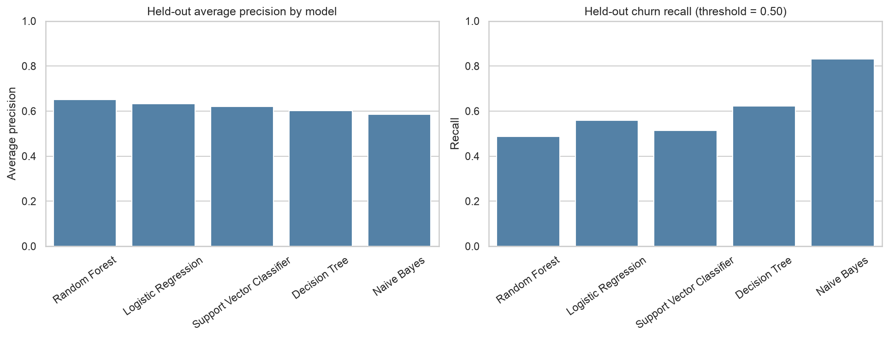
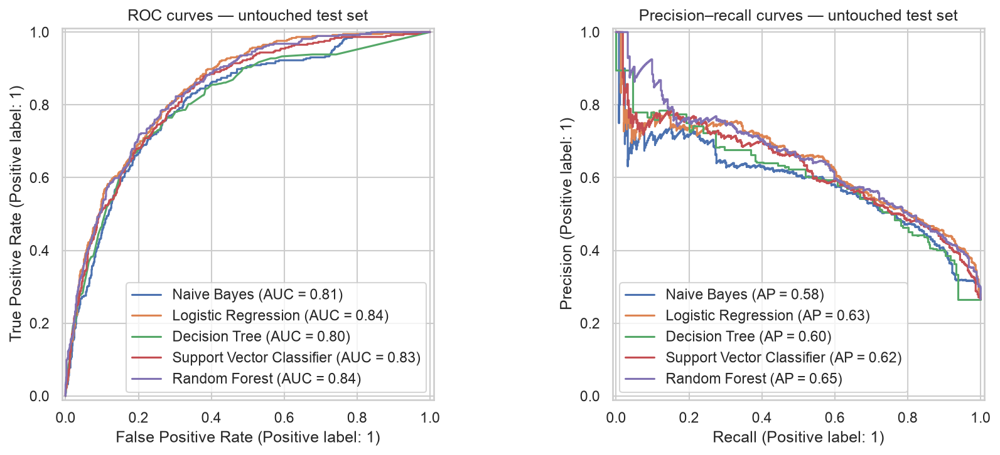
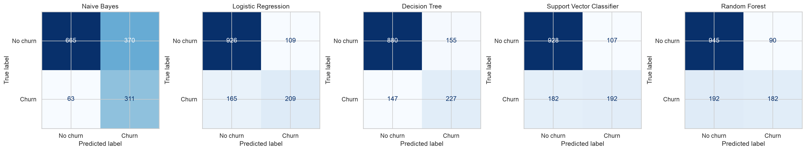

# Predicting Subscription Renewal Risk and Customer Churn Using Machine Learning

**Technical Capstone Report | UC Berkeley Professional Certificate in Machine Learning and Artificial Intelligence — Capstone 24.1**  
**Author:** Trilok Reddy Arava

[Main project README](README.md) · [Nontechnical report](README_NON_TECHNICAL.md) · [Project notebooks](#outline-of-project)

## Executive summary

### Project overview and goals

This supervised binary-classification study uses the public IBM Telco Customer Churn dataset (7,043 rows, 21 original columns) to estimate churn risk. It extends the Module 20 Logistic Regression baseline with Naive Bayes, Decision Tree, linear Support Vector Classifier, and Random Forest. All comparisons preserve the original stratified 80/20 holdout partition (`random_state=42`).

### Findings

The observed churn prevalence is **26.54%**. Segment associations include month-to-month contracts (**42.71%** churn), electronic-check payment (**45.29%**), and fiber-optic internet (**41.89%**). These associations are not causal effects.

### Results and conclusion

Logistic Regression achieved the highest **training-only three-fold stratified cross-validation average precision (0.6602)** and was selected before test evaluation. On the 1,409-row holdout, it achieved **accuracy 0.8055**, **churn precision 0.6572**, **recall 0.5588**, **F1 0.6040**, **ROC-AUC 0.8419**, and **average precision 0.6334**. At threshold 0.50, its confusion matrix is TN=926, FP=109, FN=165, TP=209.

### Future research and development

Evaluate temporal and external validation, probability calibration, threshold optimization using separate validation data, subgroup stability, drift monitoring, alternative feature sets, and causal impact of retention interventions.

### Next steps and recommendations

Use the model only as a candidate risk-ranking tool for a consent- and privacy-reviewed pilot. Set outreach thresholds based on business costs and validation data, and evaluate retention uplift through randomized testing. Do not treat feature importance as causal evidence.

## Rationale

The target is customer churn (`ChurnFlag` = 1 for `Yes`, 0 for `No`). Because churn is the minority class, accuracy alone can mask missed churners. Average precision is the **primary model-selection criterion**; precision, recall, F1, ROC-AUC, and confusion matrices provide complementary diagnostics.

## Research Question

**Can machine learning identify customers at greater risk of churn and highlight patterns that could help prioritize retention outreach?**

## Data Sources

- [IBM Telco Customer Churn CSV](data/Telco-Customer-Churn.csv): 7,043 rows and 21 original columns.
- Target: `Churn` → binary `ChurnFlag`.
- Features include tenure, contract, internet service, payment method, monthly charges, total charges, and add-on services.
- This is a public historical telecom proxy; it does not contain actual SaaS renewals or confidential CRM data.

### Exploratory data analysis

The exploratory notebook examines class distribution, categorical churn rates, numeric distributions, correlations, and engineered customer segments. Supporting figures include [segment churn rates](outputs/figures/02_categorical_churn_rates.png), [numeric distributions](outputs/figures/03_numeric_distributions.png), and [correlations](outputs/figures/04_numeric_correlations.png). A [data dictionary](outputs/reports/data_dictionary.csv) and [data-quality audit](outputs/reports/data_quality_summary.csv) document the source fields.

### Cleaning and preparation

Convert `TotalCharges` to numeric with invalid/blank values coerced to missing (**11 blank entries**); check duplicate customer identifiers and exclude IDs from predictors. Feature engineering includes `AddOnServiceCount`; `TenureGroup` and `MonthlyChargeBand` support exploratory analysis but are excluded from the final predictor set. Missing-value handling occurs within fitted preprocessing pipelines to avoid test leakage.

### Preprocessing

`ColumnTransformer` applies median imputation and `StandardScaler` to numeric predictors, and most-frequent imputation plus `OneHotEncoder` to categorical predictors. Gaussian Naive Bayes receives a dense transformed matrix. The same training/test rows are used across all models; model fitting and hyperparameter searches use training data only. This is tabular data, so the TF-IDF text preprocessing in the exemplar is **not applicable**.

### Final Dataset

7,043 rows; **20 final predictor columns**, including engineered `AddOnServiceCount`. Stratified split: **5,634 training** and **1,409 test** observations, `test_size=0.20`, `random_state=42`.

## Methodology

Pipelines encapsulate preprocessing and estimation. **Stratified 3-fold cross-validation** with `GridSearchCV` tunes each classifier on the training partition. The primary selection metric is **average precision**; ROC-AUC, recall, F1, precision, and accuracy are reported. The held-out test partition is evaluated at the prespecified threshold of **0.50**. Selecting a different winner after inspecting holdout scores would invalidate the training-only selection procedure.

### Naive Bayes Model

`GaussianNB` provides a probabilistic benchmark with conditional-independence and Gaussian assumptions that may not hold for all encoded attributes. **CV AP 0.6134; CV ROC-AUC 0.8202.** Test: accuracy 0.6927, precision 0.4567, recall 0.8316, F1 0.5896, ROC-AUC 0.8070, AP 0.5846.

### Logistic Regression Model

The Module 20 Logistic Regression baseline is preserved. The expanded training notebook tunes regularization/class-weight settings using the same holdout split. **CV AP 0.6602; CV ROC-AUC 0.8458.** Test: accuracy 0.8055, precision 0.6572, recall 0.5588, F1 0.6040, ROC-AUC 0.8419, AP 0.6334. **Selected by training CV AP.**

### Decision Tree Model

A tuned `DecisionTreeClassifier` models nonlinear interactions and may overfit if unconstrained. **CV AP 0.5909; CV ROC-AUC 0.8013.** Test: accuracy 0.7793, precision 0.5782, recall 0.6230, F1 0.5997, ROC-AUC 0.8018, AP 0.6012.

### Support Vector Classifier Model

A linear-kernel `SVC` with probability estimates supports ROC and precision–recall analysis. **CV AP 0.6494; CV ROC-AUC 0.8342.** Test: accuracy 0.7956, precision 0.6433, recall 0.5160, F1 0.5727, ROC-AUC 0.8266, AP 0.6211.

### Random Forest Model

`RandomForestClassifier` is an additional ensemble benchmark. **CV AP 0.6531; CV ROC-AUC 0.8437.** Test: accuracy 0.8006, precision 0.6703, recall 0.4893, F1 0.5657, ROC-AUC 0.8401, AP 0.6504.

### Model evaluation and results

| Model | CV average precision | Test accuracy | Test precision | Test recall | Test F1 | Test ROC-AUC | Test AP |
|---|---:|---:|---:|---:|---:|---:|---:|
| **Logistic Regression** | **0.6602** | **0.8055** | 0.6572 | 0.5588 | **0.6040** | **0.8419** | 0.6334 |
| Random Forest | 0.6531 | 0.8006 | **0.6703** | 0.4893 | 0.5657 | 0.8401 | **0.6504** |
| Support Vector Classifier | 0.6494 | 0.7956 | 0.6433 | 0.5160 | 0.5727 | 0.8266 | 0.6211 |
| Naive Bayes | 0.6134 | 0.6927 | 0.4567 | **0.8316** | 0.5896 | 0.8070 | 0.5846 |
| Decision Tree | 0.5909 | 0.7793 | 0.5782 | 0.6230 | 0.5997 | 0.8018 | 0.6012 |

Training CV AP for Logistic Regression narrowly exceeded Random Forest and SVC; this does not establish statistically significant superiority. Naive Bayes has highest test recall at threshold 0.50 but incurs more false positives. Random Forest has highest holdout AP, which is **not** the precommitted model-selection criterion. All test figures are from the original holdout, not an independent external validation cohort.

### Model interpretation and validation

[Permutation importance](outputs/figures/12_final_feature_importance.png) highlights tenure, internet service, monthly charges, contract type, and total charges as important predictors for the selected model. Permutation importance describes predictive reliance, not causation. [Illustrative customer predictions](outputs/reports/illustrative_customer_risk_examples.csv) and [top-decile risk report](outputs/reports/illustrative_top_decile_risk_report.csv) demonstrate possible prioritization, but do not validate outreach effectiveness.

## Outline of project

- [Notebook 01 — Complete capstone](notebooks/Subscription_Churn_Evaluation.ipynb)
- [Notebook 02 — Data setup and preprocessing](notebooks/Subscription_Churn_Prediction.ipynb)
- [Notebook 03 — Model training, hyperparameter tuning, and comparison](notebooks/Subscription_Churn_Prediction.ipynb)
- [Notebook 04 — Final evaluation and findings](notebooks/Subscription_Churn_Evaluation.ipynb)
- [Dataset](data/Telco-Customer-Churn.csv) · [CV results](outputs/reports/cross_validation_results.csv) · [Holdout results](outputs/reports/final_model_comparison.csv) · [Dependencies](requirements.txt)

### Reproducibility and execution status

From the project root, run `pip install -r requirements.txt` and launch Jupyter. Either execute the **complete Notebook 01** or follow the modular workflow **Notebook 02 → Notebook 03 → Notebook 04**. Notebook 03 writes model artifacts and reports consumed by Notebook 04. Avoid running the complete and modular model-training workflows together unless repeating tuning is intentional. The model scripts previously produced the included reports; **a full clean Jupyter Restart & Run All for the assembled notebook set has not been independently verified** and remains a pre-submission check.

## Contact and Further Information

**Trilok Reddy Arava**  
UC Berkeley Professional Certificate in Machine Learning and Artificial Intelligence
